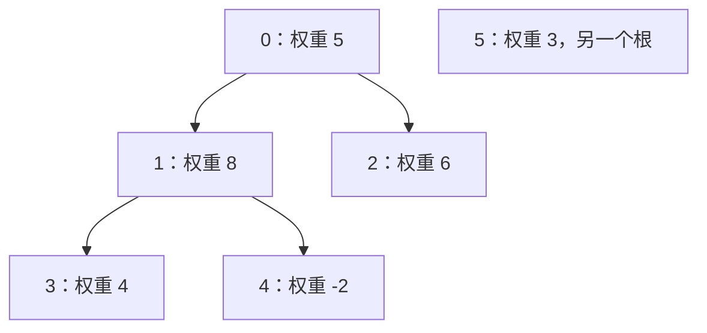

# 动态规划进阶练习：先固定状态，再检查依赖

[教材目录](textbook/index.md) · [编程练习与运行](programming-practice.md) · [回溯、贪心与动态规划入门练习](strategy-practice.md) · [学习记录模板](learning-log-template.md)

依次阅读[第 28 章：背包问题](textbook/28-knapsack.md)、[第 29 章：序列动态规划](textbook/29-sequence-dp.md)和[第 30 章：区间与树形动态规划](textbook/30-interval-tree-dp.md)。每章有 5 节讲解、2 个原创例题、3 道练习及完整解答，共 30 段独立程序。先遮住输出手算，再运行代码，最后改变约束，判断原状态是否仍足够。

## 背包：先把四个问题说清楚

| 要求 | 状态中保存什么 | 初值与更新依据 |
| --- | --- | --- |
| 每个位置一次，重量不超过容量 | 前 i 件、容量上限 c 的最大价值 | 空物品行全为 0；只读前一行；压缩时倒序 |
| 每种类型无限件，重量不超过容量 | 所有类型在容量上限 c 下的最大价值 | 空方案为 0；正重量保证依赖更小容量，按容量递增 |
| 每个位置一次，重量恰好等于目标 | 恰好重量 s 的最大价值或不可达 | 只有空前缀、重量 0 可达；其他初始状态为 None |
| 每个位置一次，统计恰好重量方案数 | 位置子集数量 | 空子集计一次；零重量可使已有数量翻倍 |

用重量 `[0,2,3]`、价值 `[4,-3,2]` 检查模型：恰好重量 5 时必须包含负价值物品，答案为 3；只要求不超过 5 时可以留下空余，答案为 6。两个答案都应包含零重量正价值物品。把恢复循环改成“容量为正才继续”会漏掉某些零重量选择。

完全背包统一拒绝零重量类型。零重量正价值会使最优值无上界；本实现没有定义“无限价值”的返回格式。0/1 背包的零重量物品仍只有一件，状态中的物品数量会下降。

对 `[1,3,4]` 凑出 6，写出四种件数组合，再展开为九个有序序列。解释面额外层与金额外层分别按什么分类。面额计数接口拒绝重复面额；位置子集计数则保留重复重量的不同位置。

## 序列：不要只看最后一个数字

| 返回结果 | 检查内容 |
| --- | --- |
| LCS 的位置对 | 两列下标严格递增、码点相同、对数等于最优长度 |
| 编辑对齐列 | 去除每侧的 None 后分别还原源串和目标串；非相同列数等于距离 |
| LIS 的原下标 | 原位置递增、所选数值严格递增、长度达到独立枚举的最优值 |
| 公共连续子串起点与长度 | 两个切片相同、没有跳过中间位置、平局满足题目规定 |

本章字符串按 Unicode 码点比较。预组成的 `é` 与 `e` 加组合重音符可能显示相似，长度却分别为 1 和 2；教材不做归一化。练习时同时保留字符内容和原位置，避免把显示字形数、码点数与字节数混在一起。

以 `a` 和 `aa` 手算一行 LCS：更新当前格时，数组同列是旧上方，左邻是新左方，另存的 `diagonal` 是旧左上方。若把新左方当对角，会把同一个 `a` 重复匹配。最长公共连续子串的失配格必须归零；LCS 则允许跳过一端，这两种转移不能混用。

把 `cat` 改为 `cut`，允许替换只需 1 步；只允许插入删除需要 2 步。先写清操作集合，再使用 `n+m−2L` 公式。把相邻交换也视作一次操作，会得到另一个问题。

## 区间：重放合并记录

维度 `[6,2,7,3]` 对应三个矩阵。先算左侧需要 `84+126=210` 次标量乘法，先算右侧只需 `42+36=78` 次。最优操作记录为：

| 顺序 | 记录 | 必须已完成的两段 | 新结果 |
| --- | --- | --- | --- |
| 1 | `[1,2,3]` | `[1,2)` 与 `[2,3)` | `[1,3)`，形状 2×3 |
| 2 | `[0,1,3]` | `[0,1)` 与 `[1,3)` | `[0,3)`，形状 6×3 |

记录的下标属于原矩阵序列，合并之后不重新编号。栈恢复先压自身完成标记、再右、再左，实际执行左、右、自身。每个非空 n 矩阵方案应有 n−1 次操作。

再看相邻块 `[4,1,3,2]`：先合并 1 与 3，再与 2 合并，最后与最左 4 合并，费用 `4+6+10=20`。任意两块模型得到的 19 使用了不相邻的块，在这里不可执行。模型新增一条限制，原来的贪心最优性就需要重新检查。

## 树形：孩子状态包含整个子树



父表为 `[-1,0,0,1,1,-1]`。结点 1 选中时得 8，不选时可从孩子得到 4；结点 0 选中时得 9，不选时得 14；另一个根贡献 3，返回结点 `[1,2,5]`、总权重 17。

| 任务 | 强制选当前结点 | 强制不选当前结点 |
| --- | --- | --- |
| 最大权独立集 | 自身权重 + 每个孩子“不选”的最优值 | 各孩子“选／不选”较大值之和 |
| 最小权顶点覆盖 | 自身费用 + 各孩子两状态较小值之和 | 所有孩子“选”的最优值之和 |
| 独立集计数 | 所有孩子“不选”的数量相乘 | 各孩子两状态数量之和，再相乘 |

将父表重新编号，让父亲编号大于孩子，检查算法仍然成立。依赖顺序来自森林结构，不来自编号大小。`[1,0]` 或 `[-1,2,1]` 都含循环，必须拒绝；后者即使有一个根，也不能忽略未连到根的循环分量。

零费用覆盖还要检查边：费用 `[0,0]` 的一条边，选择任一端都可达零费用，但空集无法覆盖它。空森林有一个空独立集，计数为 1；最大权和最小费用则为 0。

掌握这些状态依赖后，可按[字符串、Trie 与区间技巧练习指引](string-window-practice.md)继续第 31–33 章，比较前缀表、前缀树与前缀和各自保存的信息。

## 记录一次可复查的练习

为每题写下状态的一句话定义、初值、依赖顺序、返回方案及一组失败输入。成本要包含输入验证、初始化、复制与结果；“线性个整数槽位”不等于大整数只占线性位数。

```bash
cs-study-map study --chapter 28-knapsack --status reading
cs-study-map study --chapter 29-sequence-dp --status reading
cs-study-map study --chapter 30-interval-tree-dp --status reading
```

完成自己的练习后再标记 `completed`。可记录“恰好状态误设为零”“旧对角被覆盖”“恢复提前合并未完成区间”“把循环分量忽略”等具体问题。程序执行、穷举范围及长链检查见[验证记录](verification.md)；教材保留 AI 草稿标记，外部学科复核和试学仍待开展。
