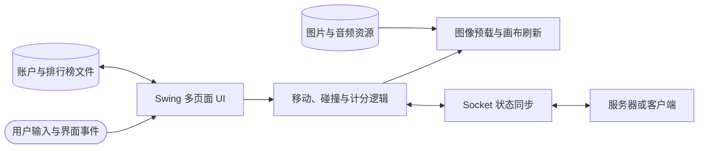

# Java 台湾小学期：学生掌握清单

*根据本目录中的 14 组递进作业、86 个 Java 源文件、课程体验记录，以及网络版贪吃蛇大作业报告与源码整理。目标是从 Java 基础一路打通到桌面 GUI、并发、网络和综合工程。*

---

## 📋 课程画像

本目录呈现的是一条非常清楚的实践路线：先用小题熟悉语法和算法，再通过连续作业掌握面向对象、异常、文件、Swing、线程、Socket 和集合，最后完成一个包含界面、游戏逻辑、网络同步和本地数据的综合项目。

原 README 记录这是一门约 5 周的交流小学期课程，前后分别在两所清华学习；其中对作业量、考试和大作业评分的描述属于当届学生的个人体验，不应当作正式教学大纲。完整原文保留在文末。

学生最终不应停留在“代码能跑”，而应达到以下标准：

- 能把问题拆成数据、类、方法和模块
- 能解释程序状态如何变化，以及错误为何发生
- 能在 GUI、后台任务和网络通信之间安全传递数据
- 能通过测试、打包和说明文档交付一个可复现作品

## 🎯 结课能力

- 熟练使用变量、表达式、分支、循环、数组、字符串、方法和递归解决小型问题
- 能为复数、分数、大整数、日期、账户、角色和游戏实体建立合理的类模型
- 能正确使用封装、构造器重载、继承、抽象类、接口、重写和运行时多态
- 能设计、抛出、捕获和传播异常，并为错误输入提供清晰反馈
- 能读取、写入、解析和遍历文件与目录，并正确管理 I/O 资源
- 能使用 Swing/AWT 完成布局、菜单、绘图、动画和事件响应
- 能识别数据竞争，使用线程协作完成并行任务，并验证并行结果的正确性
- 能用 Socket 和流设计简单协议，处理服务器、客户端、断线和状态同步
- 能根据用途选择 `ArrayList`、`HashMap`、`TreeSet`、迭代器和泛型
- 能把界面、业务逻辑、网络和本地数据组织成一个完整项目

## 📚 14 组作业的知识主线

| 作业 | 代表任务 | 学生必须掌握 |
|---|---|---|
| `hw1` | 完全数、时间换算、计算器、进制转换 | 控制流程、输入输出、数组与字符串、递归求最大公约数、数制转换 |
| `hw2` | 复数、分数、40 位大整数 | 类与构造器、对象运算、数组表示大数、符号处理、比较与边界测试 |
| `hw3` | 日期与储蓄账户 | 构造器重载、日期合法性、闰年、对象间计算、静态成员与实例成员 |
| `hw4` | 角色、学生和车辆体系 | 多层继承、`super`、访问控制、字段扩展、方法重写 |
| `hw5` | 银行账户、人员、图形 | 抽象类、抽象方法、接口、父类引用、对象数组和动态绑定 |
| `hw6` | 键盘输入、递归幂、三角形 | 自定义异常、`throw`/`throws`、多重 `catch`、输入校验、前置条件 |
| `hw7` | 删除注释、数据排序、目录树 | 文件流、文本解析、递归遍历、状态式处理、`Comparable` 与排序 |
| `hw8` | 旋转图形动画 | `JFrame`、自定义绘制、`Graphics`、缓冲图像、`repaint` 与动画循环 |
| `hw9` | 计算器界面、文字颜色切换 | Swing 组件、布局管理器、单选按钮、监听器与界面状态 |
| `hw10` | 菜单与简易记事本 | `ActionListener`、文件选择器、过滤器、打开/保存和异常反馈 |
| `hw11` | 双线程写文件、竞争求和 | `Thread` 与 `Runnable`、`start`/`run`、`sleep`、非确定性和数据竞争 |
| `hw12` | 并行求和、并行矩阵乘法 | 任务切分、共享结果、`synchronized`、`wait`/`notify`、性能与正确性对照 |
| `hw13` | 网络井字棋 | Swing 与 Socket 结合、服务端/客户端、流协议、收发线程和游戏状态同步 |
| `hw14` | 列表过滤、替换加密、随机去重 | 泛型集合、迭代器安全删除、键值映射、有序去重和随机数据 |

建议每组作业都完成三次学习：先不看答案独立实现，再阅读现有源码比较设计，最后针对边界、资源释放和异常处理做一次重构。

## ⚙️ 必须掌握的 Java 知识

| 知识域 | 核心概念 | 能力验收 |
|---|---|---|
| 基础语法 | 类型、运算符、分支、循环、数组、字符串、输入输出 | 能独立完成数值、文本和二维数据题 |
| 算法基础 | 枚举、递归、排序、进制转换、矩阵、碰撞与胜负判断 | 能说明正确性、边界和大致开销 |
| 类与对象 | 字段、方法、构造器、`this`、`static`、对象协作 | 能把数据与行为封装到职责清晰的类中 |
| 继承与多态 | `extends`、`super`、重写、向上转型、动态绑定 | 能通过统一父类型处理不同子类对象 |
| 抽象与接口 | 抽象类、抽象方法、接口、`implements` | 能用稳定抽象隔离变化的实现 |
| 异常机制 | `try`、`catch`、`finally`、`throw`、`throws`、自定义异常 | 能区分可恢复错误与应向上传递的问题 |
| 文件系统 | `File`、字节/字符流、缓冲、扫描、输出、目录递归 | 能安全完成读写、转换、排序和目录清单 |
| 泛型与集合 | `Comparable`、`List`、`Map`、`Set`、`Iterator` | 能按顺序、去重、键值查询和修改方式选择容器 |
| 图形界面 | Swing 组件、布局、菜单、对话框、绘制和事件模型 | 能完成可操作的多组件桌面程序 |
| 图像与动画 | `paintComponent`、`Graphics`、图片加载、双缓冲、刷新节奏 | 能避免重复 I/O，并让动画稳定刷新 |
| 并发 | 线程创建、生命周期、共享状态、可见性、互斥、等待与通知 | 能解释竞争结果并实现可验证的线程协作 |
| 网络 | IP/端口、`ServerSocket`、`Socket`、数据流、消息边界 | 能实现一次可靠的连接、收发和关闭流程 |
| 序列化 | `Serializable`、对象流、协议兼容和状态传输 | 能说明对象传输的便利与耦合风险 |
| 构建与交付 | 包、类路径、`.class`、JAR、资源路径、运行入口 | 能从源码构建并用统一命令运行作品 |
| 测试与调试 | 测试驱动类、边界用例、单/多线程结果对照、日志 | 能定位编译、运行、并发和协议问题 |

## 🔗 全阶段学习路线

```mermaid
flowchart LR
    accTitle: Java 台湾小学期学习路线
    accDescr: 学生从基础编程出发，依次掌握面向对象、可靠性、桌面界面、并发、网络和集合，最后完成综合项目。

    basics["基础语法与算法"] --> object_model["类设计与对象协作"]
    object_model --> polymorphism["继承、接口与多态"]
    polymorphism --> robust_io["异常与文件处理"]
    robust_io --> desktop_ui["Swing 界面与绘图"]
    desktop_ui --> concurrency["线程、同步与性能"]
    concurrency --> networking["Socket 与状态同步"]
    networking --> collections["集合与泛型"]
    collections --> final_project["综合桌面网络项目"]
```

| 阶段产出 | 最低要求 |
|---|---|
| 小程序集 | 输入输出明确，边界测试完整，方法职责清楚 |
| 对象模型 | 至少三个协作类，包含继承或接口，并能说明设计理由 |
| 文件工具 | 能处理真实文件、错误路径和异常输入 |
| 桌面应用 | 布局合理、事件有效、打开和关闭行为正确 |
| 并发实验 | 同时展示错误竞争结果与修复后的确定结果 |
| 网络程序 | 两端可以连接、通信、同步状态并处理断线 |
| 综合项目 | 可构建、可运行、可演示、可解释、可复现 |

## 📦 贪吃蛇大作业能力

大作业报告把系统分为 UI、游戏逻辑和网络传输三个主要模块，源码还加入本地账户、排行榜、聊天、音频和资源加载。学生应理解的不是某个具体游戏，而是模块之间如何协作。

### 架构与设计

- 分离界面切换、游戏规则、绘制和网络收发，避免单个类承担所有职责
- 用 `Entity`、`Snake`、`Wall` 等类型表达领域对象，通过继承和重写扩展食物、障碍、洞和墙体
- 通过参数传递地图状态，让底层对象完成移动、碰撞和绘制
- 使用预加载图片减少动画过程中的文件读取
- 将蛇的移动拆成头部增长与尾部移除，便于表达增长、进洞和复活

### 网络与并发

- 理解“双方各自计算”容易因消息丢失产生状态分叉
- 理解“服务器权威计算、客户端负责输入和绘制”的一致性优势与通信开销
- 能为方向、实体、聊天、开始信号和连接检查定义明确消息
- 能使用对象序列化或文本协议传输状态，并处理消息边界与版本变化
- 能让网络接收、游戏循环和界面刷新并行工作，同时保护共享状态
- 能处理连接失败、断线、超时、重复操作和游戏结束后的资源回收

### 数据与交付

- 能读取和更新排行榜，并保持排序、去重和文件一致性
- 能加载图片、字体和 WAV 音频，并使用类路径或相对资源路径打包
- 能构建带入口的可执行 JAR，并在干净环境验证运行方法
- 能写清架构、关键算法、权衡、已知问题、运行步骤和测试范围
- 能识别文本文件保存用户名与密码的局限，不把练习性登录实现当作真实安全方案

## ⚠️ 阅读现有源码时的注意事项

这些文件是历史作业成果，适合学习知识递进和设计思路，但不应被当作无需质疑的标准答案。

- 部分 `.java` 文件名与其中的 `public class` 名称不一致，重新编译前需要先理解原有包结构
- 个别源码写有 macOS 绝对路径，综合项目也只记录了有限环境测试，应改用可移植资源路径
- 一些输入流、输出流和扫描器没有完整关闭，适合重构为明确的资源生命周期
- 多处 `catch` 为空，会隐藏失败原因；应保留上下文并向用户或调用者报告错误
- `hw11` 有意展示数据竞争，`hw12` 的等待/通知代码也应重点检查锁对象和等待条件
- Swing 耗时任务、游戏循环和网络接收不应阻塞事件分派线程，界面更新也要注意线程边界
- 网络消息采用文本和对象流混合方式，阅读时要检查握手顺序、消息边界和断线恢复
- 代码年代较早，API 与编码习惯可用于理解原理；现代化时应先补测试，再逐步重构

## ✅ 学生自测清单

### 语言与面向对象

- [ ] 我能独立完成完全数、进制转换、矩阵和字符串处理题
- [ ] 我能用数组实现大整数加减，并覆盖正负号、进位和借位
- [ ] 我能设计复数、分数、日期等值对象，并保持对象状态合法
- [ ] 我能解释重载、重写、抽象类、接口和动态绑定的区别
- [ ] 我能用父类引用、对象数组和方法参数展示多态

### 可靠性与数据

- [ ] 我能定义自定义异常，并决定在何处抛出、捕获或继续传播
- [ ] 我能递归遍历目录，并安全处理不存在、空目录和权限失败
- [ ] 我能解析文本、排序对象并把结果写入新文件
- [ ] 我能为 `equals`、`hashCode`、`compareTo` 和集合选择说明契约
- [ ] 我能保证文件、流、Socket 和音频资源在结束时释放

### 界面、并发与网络

- [ ] 我能用布局管理器完成可调整大小的 Swing 界面
- [ ] 我能正确处理按钮、单选、键盘、鼠标和窗口事件
- [ ] 我能用缓冲图像和刷新循环完成平稳动画
- [ ] 我能复现实验中的数据竞争，并用正确同步得到确定结果
- [ ] 我能把并行求和或矩阵任务切分、汇总并与单线程结果核对
- [ ] 我能完成服务端监听、客户端连接、双向收发和异常关闭
- [ ] 我能解释服务器权威同步与双方本地计算的取舍

### 综合交付

- [ ] 我能从源码重新构建项目，而不是只依赖已有 `.class` 或 JAR
- [ ] 我能在另一台机器验证资源路径、编码、网络地址和运行方式
- [ ] 我能用图说明 UI、逻辑、网络和数据之间的关系
- [ ] 我能演示正常流程、边界输入、断线恢复和已知限制

## 🗂️ 本目录资料怎么用

| 资料 | 主要用途 | 建议顺序 |
|---|---|---|
| `hw/hw1`—`hw/hw3` | 基础编程、类设计、构造器和静态成员 | 第一阶段 |
| `hw/hw4`—`hw/hw6` | 继承、多态、抽象、接口和异常 | 第二阶段 |
| `hw/hw7` | 文件、目录、解析、排序和递归 | 第三阶段 |
| `hw/hw8`—`hw/hw10` | Swing 绘图、布局、事件、菜单和文件对话框 | 第四阶段 |
| `hw/hw11`—`hw/hw12` | 线程竞争、同步、并行计算和性能比较 | 第五阶段 |
| `hw/hw13` | 网络井字棋、Socket、收发线程和状态同步 | 第六阶段 |
| `hw/hw14` | `ArrayList`、`HashMap`、`TreeSet` 与迭代器 | 第七阶段 |
| `hw/大作业-s2016011286/大作业报告.pdf` | 先理解贪吃蛇架构、算法与网络权衡 | 大作业先读 |
| `hw/大作业-s2016011286/GreedSnake/` | 对照报告研究完整源码与资源组织 | 大作业后读 |
| `hw/大作业-s2016011286/ReadMe.txt` | 查看原项目运行与操作说明 | 运行前读 |

阅读每个作业时，优先看 `.java` 和对应 `Test.java`；已有 `.class` 与 JAR 只用于对照运行结果，不应替代重新构建和验证。

## 📌 原 README 记录

<strong>📋 展开查看原课程体验记录</strong>

以下内容为原 README 原文，仅作资料归档：

#### Tips

* 选课说明：这个课一共5周时间，前一半在清华上，后一半去台湾清华大学上，老师都是清华大学的老师
* 评价：往届据说都是去玩的，我们遇到了一个很为我们着想的助教，怕我们全去玩了耽误学业，就留了很多的作业，一共玩的时间<=4天（手动滑稽）
* 考试：老师说考试很简单，往届很简单，而我们。。。反正我gg
* 大作业：助教大作业的给分，往届很好，而我们。。。反正我gg
* 希望之后换个助教吧

---

## 🏁 完成标准

真正完成这门课，应同时达到四点：

1. **会写小程序**：能独立解决基础算法、对象建模、文件和集合问题。
2. **会处理复杂状态**：能正确组织 GUI 事件、线程协作和网络消息。
3. **会做完整项目**：能交付一个分层清楚、可构建、可运行的桌面应用。
4. **会验证与说明**：能用测试、运行记录、架构图和报告证明作品可靠。
