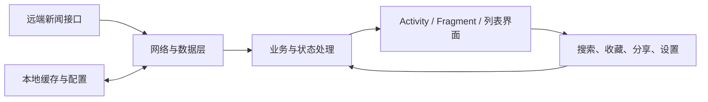
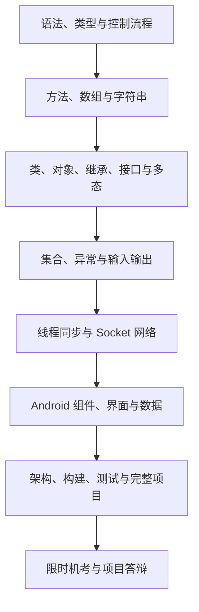

# Java 程序设计与训练：学生掌握清单

*根据本目录中的机考说明、历史试题、创意展示，以及 Android 新闻客户端大作业的报告与源码整理。目标是把 Java 语言、限时编程和完整应用开发贯通起来。*

---

## 🧭 课程定位

这门课不是只记语法，也不是只会照着示例拼界面。学生最终应形成三层能力：

1. **语言层**：能准确阅读、编写和调试 Java 程序，理解代码为什么这样运行。
2. **问题层**：能在有限时间内把题意转化为可运行程序，并主动检查边界情况。
3. **工程层**：能把 Java 用于一个可演示、可测试、可维护的 Android 应用。

目录内的考试说明指出，考核已转为 **2 小时完成 8 道编程题** 的机考形式，而且题目逐年变化。因此，旧试卷主要用于查漏补缺，真正的目标是现场写出正确程序，而不是背答案。

## 🎯 结课时应具备的能力

- 能独立完成从需求理解、类设计、编码、运行到调试的完整过程。
- 能判断常见代码的编译结果、运行结果，以及异常发生的原因。
- 能用面向对象方法拆分职责，合理使用继承、接口、组合和多态。
- 能处理集合、文件、异常、线程与网络通信等实际问题。
- 能完成 Android 客户端的界面、数据、网络、缓存和异步任务协作。
- 能使用构建、版本管理和测试手段保证项目可运行、少崩溃、易维护。
- 能从用户需求出发提出功能方案，说明技术可行性，并完成演示与总结。

## 📚 Java 核心知识

| 模块 | 必须理解 | 必须会做 |
|---|---|---|
| 程序结构 | `package`、`import`、类、`main` 方法、源文件与类名关系 | 从零建立可编译运行的程序，读懂编译错误 |
| 类型与表达式 | 基本类型、包装类、类型转换、作用域、默认值、运算符、短路求值、位运算 | 判断表达式类型与结果，避免溢出、空值和越界错误 |
| 流程控制 | `if`、`switch`、`for`、`while`、`break`、`continue` | 把题目拆成分支与循环，写出清晰的控制流程 |
| 方法 | 参数传递、返回值、局部变量、递归、方法重载 | 设计小而清晰的方法，理解对象引用与基本类型参数的行为 |
| 数组与字符串 | 一维/二维数组、初始化、遍历、`String` 的不可变性、`==` 与 `equals` | 完成统计、查找、排序、矩阵和文本处理任务 |
| 类与对象 | 字段、方法、构造器、`this`、`super`、`static`、`final`、对象生命周期 | 为实际问题建模，正确初始化和使用对象 |
| 封装与访问控制 | `private`、默认、`protected`、`public` | 隐藏实现细节，通过稳定接口暴露能力 |
| 继承与多态 | `extends`、方法重写、动态绑定、向上转型、向下转型、`instanceof` | 根据运行时对象判断调用结果，避免错误类型转换 |
| 抽象与接口 | 抽象类、接口、`implements`、组合优先的职责拆分 | 用接口隔离模块，并为替换实现和测试留出空间 |
| `Object` 约定 | `toString`、`equals`、`hashCode` | 为值对象定义合理的相等关系，正确放入集合 |
| 内部类型 | 成员内部类、局部内部类、匿名实现、枚举 | 读懂事件监听器和 Android 回调中的内部类型 |
| 异常 | 受检/非受检异常、`try`、`catch`、`finally`、`throw`、`throws`、自定义异常 | 捕获可恢复问题、传递不可处理问题，并保留有用错误信息 |
| 集合 | `List`、`Set`、`Map`、迭代器，以及 `ArrayList`、`HashSet`、`HashMap` 的典型用法 | 根据是否有序、是否去重、是否按键查询选择容器 |
| 泛型与 Lambda | 类型参数、类型边界、通配符、函数式接口和 Lambda 表达式 | 写出类型安全的容器与通用方法，读懂回调和异步数据处理链 |
| 输入输出 | 字节流、字符流、缓冲流、文件与目录、随机访问、序列化概念 | 完成文件复制、文本追加、资源关闭和简单持久化 |
| 并发 | `Thread`、`Runnable`、`start`/`run`、线程状态、`sleep`、互斥与共享数据 | 创建并协调线程，用 `synchronized` 防止共享数据不一致 |
| 网络 | `Socket`、`ServerSocket`、输入输出流、请求—响应协议 | 编写简单客户端/服务器，并支持多个客户端与异常清理 |
| 事件与界面 | 组件、布局、绘制、监听器、事件回调 | 理解事件驱动程序；能把同一思想迁移到 Android 界面 |
| 运行环境 | Java 平台、包、字节码、垃圾回收的基本概念 | 区分编译期错误、运行期异常和逻辑错误 |

## ⏱️ 限时编程能力

机考训练应覆盖以下动作，而不只是“看懂答案”：

- 快速提取输入、输出、约束和特殊情况。
- 先写出正确的直接方案，再根据数据规模调整实现。
- 熟练处理数组、字符串、二维数据、排序、查找和简单模拟。
- 能独立写类、构造器、方法、异常处理、文件读写和线程程序。
- 用样例之外的数据自测：空输入、单元素、重复值、极值、越界和空引用。
- 出错时先判断是编译错误、运行异常还是逻辑错误，再定位最小问题。
- 保持统一命名、缩进和方法拆分，使代码能在压力下快速检查。

建议把历史试题中的代码判断题改成实际实验：先手算结果，再编译验证，最后解释原因。最终验收则按目录说明，进行一次不查资料的 **120 分钟、8 题完整模拟**。

## 📱 Android 综合项目能力

本目录的大作业主线是新闻客户端。学生不必复制优秀作品的全部高级功能，但应掌握一个完整客户端的核心数据链路：

| 工程模块 | 应掌握的知识与能力 |
|---|---|
| 需求与原型 | 明确目标用户、核心痛点、功能优先级和异常场景；用原型说明交互流程 |
| Android 组件 | `Activity`、`Fragment`、应用入口、生命周期、清单配置与权限 |
| 界面与事件 | XML 布局、列表与适配器、`RecyclerView`、分页/刷新、点击与滚动事件、状态反馈 |
| 网络访问 | HTTP/API 调用、异步请求、JSON 解析、超时/断网/错误响应处理 |
| 数据模型 | 用 Java 类表示列表新闻、详情、分类、配置和用户状态 |
| 本地持久化 | SQLite、配置文件或偏好设置；保存收藏、已读记录、分类与缓存 |
| 离线策略 | 网络优先、本地回退、缓存更新与清理，保证断网时仍有合理行为 |
| 并发与响应性 | 区分主线程和 I/O 任务，避免阻塞界面，安全地把结果更新到 UI |
| 软件架构 | 分离界面、业务和数据职责；理解示例项目中的 MVP 与 Contract 接口 |
| 第三方能力 | 阅读 SDK/API 文档，完成依赖配置、权限、回调、失败处理和版本兼容 |
| 工程工具 | Gradle 构建与依赖、Git 版本管理、可重复的项目配置 |
| 测试与质量 | JUnit、Android 测试、关键数据接口测试、真机验证、崩溃与非法操作处理 |

### 基础合格线

- 应用能安装并稳定启动，常规操作不崩溃。
- 分类和新闻列表可正确展示，能够进入详情页面。
- 能刷新或加载更多，并处理加载中、空数据、失败和断网状态。
- 支持搜索、收藏/取消收藏、已读标记等至少一组完整状态操作。
- 收藏、已读记录或新闻缓存能够本地保存，重启后行为正确。
- 界面事件与后台数据逻辑分离，核心代码不是全部堆在一个页面类中。
- 项目可以用统一构建方式复现，并有基本测试或清晰的人工测试记录。

### 拓展加分方向

以下内容来自优秀项目和创意展示，适合作为深化方向，不应挤占核心功能的完成时间：

- 个性化推荐、标签画像、相似度计算与反馈更新。
- 语音合成、语音识别和命令词交互。
- 关键词提取、实体链接、多模式字符串匹配与内容过滤。
- 分享 SDK、地图、传感器、通知提醒和第三方平台集成。
- 阅读统计、数据可视化、夜间模式、无图模式和无障碍体验。
- 图片异步加载、智能补图、缓存优化与简单分类模型。

## 🔗 推荐学习路线

| 阶段 | 学习产出 |
|---|---|
| 语言打底 | 一组可独立运行的小程序，覆盖分支、循环、数组、字符串和方法 |
| 面向对象 | 一个由多个类与接口协作的小系统，并能解释设计选择 |
| 核心类库 | 文件处理、集合统计、异常恢复等实用程序 |
| 并发与网络 | 一个线程安全的简单多客户端请求—响应程序 |
| Android 基础 | 能显示远端或本地数据的列表—详情应用 |
| 综合工程 | 具备网络、缓存、状态操作、测试和说明文档的完整客户端 |
| 最终验收 | 2 小时 8 题模拟，以及对项目架构、数据流和关键难点的口头说明 |

## 🕰️ 历史资料的取舍

旧试题中的 `Applet`、AWT/Swing、旧版日期接口等内容具有明显的时代特征。学习时应这样处理：

- **保留原理**：事件监听、布局、绘制、线程、I/O、Socket、继承和接口仍能训练 Java 基础。
- **降低 API 记忆优先级**：不必把旧组件的每个方法当作现代项目主线。
- **以编译验证为准**：旧资料中存在拼写、排版和答案不一致的可能，不能机械背诵。
- **迁移到当前项目**：把事件驱动、后台任务、网络和数据持久化思想应用到 Android 客户端。

## ✅ 学生自测清单

### Java 语言

- [ ] 我能不查资料写出规范的 `main` 程序，并解释编译与运行过程。
- [ ] 我能准确判断基本类型、对象引用、数组和字符串操作的结果。
- [ ] 我能解释重载与重写、继承与组合、静态绑定与动态绑定的区别。
- [ ] 我能正确设计构造器、访问权限、接口和异常边界。
- [ ] 我能为集合中的对象正确实现 `equals` 与 `hashCode`。
- [ ] 我能完成文件复制、文本追加和资源安全关闭。
- [ ] 我能创建线程，并保护多个线程共享的数据。
- [ ] 我能用 Socket 完成一次清晰的请求—响应通信。

### 编程与调试

- [ ] 我能在读题后快速写出输入、处理和输出框架。
- [ ] 我会主动测试空值、边界、重复、越界和异常输入。
- [ ] 我能根据错误信息定位到具体语句，而不是盲目改代码。
- [ ] 我能在 120 分钟内完成一次 8 题模拟并复盘失分原因。

### Android 项目

- [ ] 我能说明一个新闻数据从 API 到界面再到本地缓存的完整路径。
- [ ] 我能实现列表、详情、搜索、收藏和离线读取中的主要功能。
- [ ] 我不会在主线程执行耗时网络、数据库或大文件操作。
- [ ] 我能处理加载、空数据、断网、权限失败和第三方 SDK 回调异常。
- [ ] 我能解释项目为什么这样分层，以及每个主要类的职责。
- [ ] 我能构建、安装、测试并演示项目，而不是只提交源码。

## 🗂️ 本目录资料怎么用

| 资料 | 用途 | 建议优先级 |
|---|---|---|
| `exam/readme.md` | 明确机考形式与旧试卷的定位 | 先读 |
| `exam/清华大学java试题卷3份(含答案).doc` | 系统查漏：语法、面向对象、集合、I/O、线程、网络和界面事件 | 高 |
| `exam/Java考试题.pdf` | 练习代码阅读、运行结果、填空与综合程序 | 高 |
| `exam/清华大学Java期末考试试卷及答案.pdf` | 补充历史题型与概念检查 | 中 |
| `hw/readme.md` | 明确新闻客户端大作业主线 | 先读 |
| `hw/创意比赛十佳ppt/` | 学习用户需求、产品定位、功能创意和技术可行性表达 | 中 |
| `hw/39_秦岳_大作业.zip` | 研究完整 Android 项目的架构、网络、SQLite、异步、测试和项目报告 | 高 |

阅读大作业时，建议按“项目报告 → 构建配置与清单 → 数据模型和数据层 → Presenter/Contract → 页面与适配器 → 测试”的顺序，不要一开始逐行阅读所有源码。

## 🏁 完成标准

达到以下四点，才算真正完成本课程：

1. **会写**：能在限时环境中独立完成 Java 编程题。
2. **会解释**：能说明类型、对象、异常、线程、网络和项目数据流的运行机制。
3. **会做项目**：能交付一个可安装、可演示、能处理异常状态的 Android 客户端。
4. **会保证质量**：能通过测试、构建、版本管理和文档让他人复现并理解作品。
