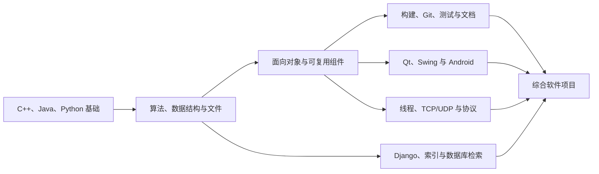

# 程序设计与软件工程：全阶段学习总览

*依据本目录十个课程文件夹中的试题、作业、课件、源码、项目报告及已有子 README 整理，用于建立跨语言、跨平台的软件开发知识体系。*

---

## 📋 目录总览

这套资料覆盖的不是一门单课，而是一条较完整的计算机程序设计培养链：从 C++、Java、Python 基础开始，经过面向对象、桌面界面、并发网络、Web 与数据检索，最后进入需求、设计、测试、协作和综合项目交付。

盘点时共有 **10 个顶层课程目录、4448 个原资料文件、536 个子目录，约 1.06 GiB**。其中既有题目和源码，也有压缩归档、生成文件、离线文档与历史构建产物；文件数量不等于学习任务数量。

阅读时应抓住三层主线：

1. **程序正确性**：能把问题建模为数据、状态和算法，并处理边界与错误。
2. **软件结构性**：能用类、接口、模块、协议和数据层组织复杂程序。
3. **工程可交付性**：能完成需求、设计、构建、测试、版本管理、性能验证和文档。

已有详细子 README 的课程可以直接进入其学习指南；其余目录的核心定位和推荐顺序已在本总览中补齐。

## 🎯 总体培养目标

完成本目录的学习后，学生应能独立做到：

- 熟练使用 C++、Java、Python 中至少一门语言，并能阅读另外两门语言的常见工程代码。
- 把题意转化为输入、输出、数据结构、算法、状态和异常路径，而不是直接堆叠语句。
- 掌握类与对象、封装、继承、接口、组合、多态、泛型/模板及资源生命周期。
- 实现排序、递归、图搜索、最短路、最小生成树、字符串匹配、回溯和相似度计算等算法。
- 编写桌面 GUI、移动客户端或 Web 应用，保持界面、业务、数据与算法职责分离。
- 使用线程、同步原语、TCP/UDP 和应用层协议构建可恢复的并发网络程序。
- 完成文件、结构化数据、网页、索引和数据库检索，并对正确性与性能进行测量。
- 从需求分析开始，完成 UML/流程建模、软件设计、编码规范、单元测试、白盒/黑盒测试和迭代计划。
- 使用 Make、CMake、qmake、Gradle、Git 等工具，让项目能够在干净环境中重新构建和运行。
- 识别历史代码中的内存、并发、协议、输入验证、密码、反序列化和依赖版本风险。

真正的完成标准不是“看完资料”，而是能从零实现、用测试证明、对设计作出解释，并把作品交给别人复现。

## 📚 十个课程目录地图

| 目录 | 课程定位 | 主要知识 | 最适合形成的产出 |
|---|---|---|---|
| [`程序设计基础`](程序设计基础/) | C++ 入门与算法训练 | 控制流程、函数、数组、字符串、递归、排序、文件 I/O、枚举与搜索、结对编程 | 命令行题集、快速排序、魔方状态与求解器 |
| [`面向对象程序设计基础-刘知远老师`](面向对象程序设计基础-刘知远老师/) | C++ OOP 概念检查 | 构造/析构、引用与指针、重载、运算符、继承、多态、`const`/`static`、模板、复制/移动、类型转换 | 面向对象知识自测与代码运行结果分析 |
| [`面向对象程序设计基础-姚海龙老师`](面向对象程序设计基础-姚海龙老师/) | C++ OOP 与研究型工程实践 | 多文件工程、资源管理、继承复用、静态库、设计模式、MST、迷宫布线、字符串匹配、代码阅读、CMake | 可复用算法库、研究问题实现、个人与团队项目报告 |
| [`Java程序设计与训练`](Java程序设计与训练/README.md) | Java 语言、限时编程与 Android | Java 核心语法、集合、异常、I/O、线程、网络、Android 界面/数据/缓存、Gradle | 2 小时机考能力与完整 Android 新闻客户端 |
| [`Java台湾小学期`](Java台湾小学期/README.md) | Java 递进实践与桌面网络项目 | 14 组作业、对象建模、Swing、文件、并发、Socket、集合、JAR | 网络贪吃蛇及一组逐步进阶的小作品 |
| [`Week_1-Qt`](Week_1-Qt/README.md) | C++/Qt 桌面应用 | qmake、对象树、信号槽、控件、事件循环、绘图、计时、拖放、资源、国际化、状态机 | 阅读器、时钟、日历、八数码/数独等桌面程序 |
| [`Week_2-Socket`](Week_2-Socket/README.md) | Qt 网络与并发编程 | TCP 字节流、UDP、消息帧、线程同步、文件传输、HTTP、分布式状态 | 网络画板、文件服务、五子棋或国际跳棋 |
| [`Week_3-Python`](Week_3-Python/README.md) | Python 数据处理与 Django | 文件搜索、HTML/PDF/CSV/XML/JSON、爬虫、分词、倒排索引、Django CRUD/认证 | 新闻、人物或美食信息检索系统 |
| [`软件工程`](软件工程/) | 软件生命周期与质量保证 | 编码规范、需求、UML、设计模式、Scrum、Git、xUnit/TDD、覆盖率、白盒与黑盒测试 | 需求与设计文档、迭代计划、自动化测试套件 |
| [`数据库专题训练`](数据库专题训练/) | 数据库新型检索技术 | Jaccard、编辑距离、q-gram、近似查询、相似连接、候选过滤、路网最短路与受约束 Top-K | 高性能相似检索器、连接器和互联网拼车查询系统 |

两套 C++ 面向对象资料的作用不同：刘知远老师目录只有一份 2017 年期中试卷，适合概念查漏；姚海龙老师目录包含连续练习、源码、代码阅读和研究型项目，适合作为完整实践主线。

## ⚙️ 核心知识体系

### 语言基础与算法

- 掌握类型、表达式、分支、循环、函数、数组、字符串、文件和命令行参数。
- 能为非法输入、空数据、越界、编码、文件失败和数值溢出建立明确处理策略。
- 掌握枚举、递归、分治、排序、二分、哈希、集合运算、图遍历和回溯。
- 理解 BFS/DFS、Prim/Kruskal、并查集、最短路、KMP、Rabin–Karp、编辑距离和 Jaccard 相似度。
- 能分析时间与空间复杂度，并用基准数据验证优化是否真实有效。

### 面向对象与资源管理

- 用类表达稳定的不变量和职责，通过构造器保证对象从创建起就有效。
- 区分重载与重写、继承与组合、静态绑定与动态绑定、接口与实现。
- 在 C++ 中理解复制/移动、析构、深浅拷贝、Rule of Three/Five、RAII 和所有权。
- 在 Java 中理解对象引用、垃圾回收与显式资源关闭；在 Python 中理解对象模型和可变性。
- 使用模板/泛型与 STL/Java 集合建立可复用组件，并遵守比较、相等和哈希契约。
- 用 Strategy、State 等模式隔离变化，但避免为了“套模式”制造不必要的层次。

### 界面、状态与应用架构

- 理解 Qt 信号槽、Swing 监听器、Android 生命周期和 Web 请求都属于事件驱动模型。
- 把业务状态保存在模型中，界面只负责输入、呈现和反馈，不能把控件文本或屏幕像素当作唯一数据源。
- 对开始、暂停、回合、连接、登录、加载、失败和完成等状态建立显式转换。
- 将界面、业务、算法、网络和持久化分层，使各层能够独立测试和替换。
- 处理耗时任务时保持界面响应，并通过受控方式把工作结果送回界面线程或请求上下文。

### 并发、网络与分布式状态

- 理解线程生命周期、共享状态、互斥、条件变量、生产者/消费者和任务依赖。
- 区分 TCP 字节流与 UDP 数据报；为 TCP 设计包含版本、类型、序列号、长度和负载的消息帧。
- 正确处理半帧、粘包、重复、乱序、超时、断线、取消、重连和资源释放。
- 文件传输采用分块、临时目标、大小限制与完整性校验，不信任远端文件名和路径。
- 联网游戏或协作系统要明确权威状态由谁维护，动作如何确认，冲突或失联后如何重新同步。

### 数据、Web 与检索

- 正确读写文本、CSV、JSON、XML、XLSX 和 PDF 抽取结果，理解格式之间并非天然无损转换。
- 用 DOM 解析 HTML，规范化字段、链接和编码，并将原始数据与清洗结果分开保存。
- 受控采集网页，完成文档 ID、分词、倒排索引、AND/OR 查询、字段筛选、摘要、高亮和分页。
- 用 Django 组织 URL、View、Template、Model、Form、ORM、迁移、CRUD、会话、认证和权限。
- 用 q-gram、长度界、前缀/倒排索引等方式减少近似查询和相似连接的候选，再进行精确验证。
- 在路网或空间任务中掌握邻接结构、最短路径、候选筛选、容量与绕路约束，以及 Top-K 结果排序。

### 软件工程与质量

- 从用户与场景出发写需求，使用用例图、序列图、泳道图、数据流或类图表达系统。
- 设计时关注职责、接口、依赖、可变点和复用边界，而不只是画图后立即编码。
- 遵循统一代码风格，并通过自动检查减少低价值格式争议。
- 使用 xUnit/TDD 编写可重复的单元测试，理解语句、分支和条件覆盖的含义与局限。
- 用等价类、边界值、状态转换和错误推测设计黑盒测试；覆盖率不能替代断言质量。
- 使用 Git、Issue 和 Scrum 维护增量、责任和进度，确保每次迭代都有可验证产物。
- 提交源码、构建配置、测试数据、设计说明、性能记录和已知限制，使项目可复现。

## 🔗 全阶段学习路线

建议按以下顺序推进：

1. **程序设计基础**：完成控制流程、函数、数组、字符串、文件和基础算法训练。
2. **面向对象基础**：先用刘知远老师试题查概念，再用姚海龙老师练习和 Java 作业落实类设计。
3. **可复用组件**：完成矩阵、MST、迷宫、字符串匹配等多文件模块，并补构建和测试。
4. **界面应用**：选择 Qt 或 Java Swing/Android，掌握事件、状态、资源和持久化。
5. **并发网络**：学习线程同步、TCP/UDP、协议帧、文件传输与服务器权威状态。
6. **Web 与数据**：完成 Python 数据抽取、Django 检索，再进入近似查询、相似连接和路网检索。
7. **综合工程**：用软件工程方法补齐需求、设计、版本管理、测试、性能、演示和文档。

软件工程不应等到最后才学习：代码风格、Git、测试和短迭代应从第一个小程序就开始，只是在综合项目阶段形成完整交付。

## 📦 建议形成的作品集

| 作品 | 对应资料 | 最低验收标准 |
|---|---|---|
| C++ 命令行题集 | 程序设计基础 | 覆盖函数、数组、字符串、文件、排序和递归；每题有边界测试 |
| 可复用算法库 | 姚海龙 OOP | 头源分离、Make/CMake、清晰接口；包含 MST、迷宫或字符串匹配中的一项 |
| 桌面应用 | Week 1 Qt 或 Java 台湾小学期 | 有状态模型、事件处理、文件/资源、异常反馈和可重复构建 |
| 移动客户端 | Java 程序设计与训练 | 列表/详情、网络请求、本地缓存、异步任务、错误状态和测试 |
| 联网程序 | Week 2 Socket | 有协议文档、消息帧、并发连接、断线处理、输入校验和一致性测试 |
| Web 检索系统 | Week 3 Python | 采集/导入、清洗、倒排索引、Django 查询、分页、权限和安全测试 |
| 高性能相似检索器 | 数据库专题训练 | 支持 Jaccard 与编辑距离，结果完整无重复，有索引与性能对比 |
| 综合查询或调度系统 | 数据库专题训练及其他课程 | 使用真实规模数据、约束筛选和 Top-K，包含 UI/API、性能与正确性验证 |
| 软件工程交付包 | 软件工程 | 需求、UML/流程、迭代计划、源码、测试、覆盖率、运行说明和复盘齐全 |

一个优秀的最终项目不必把所有技术堆在一起，但至少要贯通四层：**可靠核心逻辑、清晰软件结构、真实输入输出、可验证工程交付**。

推荐从现有大作业中任选一条深化：魔方求解、研究型图算法、Qt 日历/棋盘、网络五子棋/国际跳棋、Android 新闻客户端、Django 信息检索或互联网拼车查询。完成后再用另一门语言重写一个核心模块，可以检验自己掌握的是原理还是 API 记忆。

## 🔍 资料入口与阅读方法

### 已有详细学习指南

- [Java 程序设计与训练](Java程序设计与训练/README.md)：Java 语言、机考与 Android 项目。
- [Java 台湾小学期](Java台湾小学期/README.md)：14 组递进作业、Swing、线程与 Socket。
- [Week 1 — Qt](Week_1-Qt/README.md)：桌面界面、事件、绘图、状态与算法项目。
- [Week 2 — Socket](Week_2-Socket/README.md)：TCP/UDP、并发、文件传输与联网棋类。
- [Week 3 — Python](Week_3-Python/README.md)：数据处理、爬虫、检索与 Django。

### 尚无子 README 的目录

| 目录 | 推荐阅读顺序 |
|---|---|
| `程序设计基础` | 往年题与测试源码 → 快排结对作业 → 魔方输入/旋转 → 魔方求解大作业 |
| `面向对象程序设计基础-刘知远老师` | 逐题手算 2017 期中试卷 → 编译验证 → 将错误选项改成正确示例 |
| `面向对象程序设计基础-姚海龙老师` | Lecture 1/2 多文件与类 → MST → `const`/矩阵与资源管理 → 继承/静态库/迷宫 → KMP/Rabin–Karp 与 Strategy → 代码阅读 → 个人/团队项目 |
| `软件工程` | 需求与 UML → 软件设计与 State 模式 → 代码风格 → xUnit/TDD → 白盒覆盖 → 黑盒测试 → Scrum/Git → 期末样卷 |
| `数据库专题训练` | 近似查询 ZIP 中的说明 → 近似连接 → 互联网出行大作业；先读接口和样例，再研究性能优化 |

拆解任何历史项目时，都建议采用同一方法：

1. 先读题目或报告，写出功能、输入、输出、约束和验收标准。
2. 看构建文件和目录，区分源码、资源、测试、文档、依赖与生成物。
3. 从头文件、接口或模型开始画职责关系，再追踪关键数据流。
4. 先在小数据和受控环境中运行，补边界测试后才做性能实验。
5. 最后记录设计取舍、历史限制、失败场景和可以现代化的部分。

## ⚠️ 历史资料使用须知

- 资料跨越多个年份，包含 Python 2、Django 1.10/1.11、Qt 4/5、qmake、旧版 Android、PyUnit 1.4.1、旧 PEP8 工具和 g++ 4.8 等环境痕迹。学习应保留原理，接口与依赖则需按实际环境核对。
- `.class`、`.pyc`、可执行文件、生成头文件、构建目录、离线 API 文档和大批测试数据主要用于留档，不能替代阅读源码与重新构建。
- 压缩包可能包含重复提交、第三方库和来源不明程序。优先只读查看目录与源码，不直接运行未知二进制。
- 学生作业展示的是一种实现，不是标准答案。常见问题包括裸指针、浅拷贝、空 `catch`、绝对路径、全局状态、资源未释放和缺少边界校验。
- 网络样例常把一次 `readAll()` 当作完整 TCP 消息；Python 历史代码还可见 `eval`、不可信 Pickle 和明文密码等风险。这些应作为反例分析。
- 旧网页、API、CDN 和爬取入口可能失效。优先使用本地快照和小型固定数据测试，再在明确获准范围内访问网络。
- 部分课程资料并不完整：刘知远老师目录仅有一份期中试卷，数据库专题训练主要保存在归档中，个别说明引用的源码也可能缺失。不要把“目录里没有”误认为“不需要掌握”。
- 题目、课件、样例代码和学生答案发生冲突时，以正式题目要求和可验证行为为准，并在自己的 README 中记录假设。

## 🏁 掌握情况自检

### 编程与算法

- [ ] 我能用至少一门主语言从零完成命令行程序，并处理非法输入和文件失败。
- [ ] 我能解释数组、字符串、集合、哈希、递归、排序和图遍历的适用场景与复杂度。
- [ ] 我能独立实现 BFS/DFS、MST、最短路或字符串匹配中的至少两类算法。
- [ ] 我能建立正确性基准，用测试和性能数据判断优化是否有效。

### 面向对象与应用

- [ ] 我能为实际问题设计职责清晰的类、接口和模块，并解释为何使用继承或组合。
- [ ] 我能在 C++ 中正确处理所有权、复制/移动与资源释放，在 Java/Python 中正确管理外部资源。
- [ ] 我能完成一个事件驱动界面，并让模型、算法和界面保持分离。
- [ ] 我能完成一个带持久化、错误状态和运行说明的桌面、移动或 Web 应用。

### 并发、网络与数据

- [ ] 我能解释共享状态如何同步，并保证线程可以有界退出。
- [ ] 我能设计并实现带长度的 TCP 协议，主动测试拆包、粘包、断线和重复消息。
- [ ] 我能建立文档 ID、倒排索引或近似检索索引，并证明结果没有遗漏和重复。
- [ ] 我能处理结构化数据或路网数据，并记录时间、空间和准确性指标。

### 软件工程与交付

- [ ] 我能从需求场景形成用例、流程、模型与验收标准。
- [ ] 我能用 Git 和短迭代管理开发，并保持每个阶段可构建、可测试。
- [ ] 我能同时使用单元测试、白盒覆盖和黑盒边界用例，而不把覆盖率当成唯一目标。
- [ ] 我能提交源码、依赖/构建说明、测试数据、设计文档、性能结果和已知限制。
- [ ] 我能审查历史代码中的安全、并发、内存、协议和可移植性风险，并提出具体改法。

最终完成标准可以概括为四句话：**能写出正确程序，能设计复杂软件，能验证质量，能让别人复现并理解你的作品。**
