# Week 1 — Qt 学习指南

*本指南依据目录中的 2011—2017 年考试题、参考实现、设计文档和 2015—2017 年大作业整理，目标是把零散项目串成一条完整的 Qt 桌面开发学习路线。*

---

## 📋 资料画像

这个目录不是一周速成材料，而是一套从“小型窗口程序”逐渐过渡到“完整桌面应用与算法项目”的训练集。现有内容主要包括：

| 内容 | 主要材料 | 学习价值 |
|---|---|---|
| 历年考试 | 2011—2017 年题目及部分参考实现 | 用短项目训练控件、事件、绘图、计时器和文件操作 |
| 2015 大作业 | Flow Free Game | 训练鼠标交互、路径状态、关卡与求解算法 |
| 2016 大作业 | 桌面日历 | 训练复杂界面、日期模型、拖放、配置、国际化和多用户功能 |
| 2017 大作业 | Sudoku Game | 训练数独建模、回溯求解、题目生成、撤销/重做和游戏状态管理 |
| 工程样例 | `.cpp`、`.h`、`.ui`、`.pro`、`.qrc`、`.ts/.qm` | 观察一个传统 Qt 工程如何组织、构建和发布资源 |

目录主体采用 Qt 4/Qt 5 时代常见的 qmake 工程结构。学习时应把它看作“知识与设计案例库”，不必机械照搬所有旧写法。

## 🎯 学完后应具备的能力

学生应能独立完成以下事情：

1. 创建并读懂一个由头文件、源文件、界面文件、资源文件和 `.pro` 文件组成的 Qt 工程。
2. 正确选择并组合 `QWidget`、`QDialog`、`QMainWindow` 及常用控件，使用布局管理界面。
3. 使用信号与槽组织交互，理解 Qt 事件循环和对象父子关系。
4. 处理鼠标、键盘、计时器、菜单、快捷键、文件选择、拖放及自定义绘制。
5. 把界面、业务状态、数据持久化和算法分层，避免把全部逻辑堆进窗口类。
6. 为程序加入撤销/重做、资源管理、国际化、声音和配置导入导出等完整应用能力。
7. 能从需求文档开始，完成设计、实现、调试、测试和说明文档。

## 📚 历年考试知识主线

| 年份 | 题目脉络 | 学生应抓住的知识 |
|---|---|---|
| 2011 | 文本阅读器、数字时钟、可移动圆形 | 菜单与文件读取、`QTime`/`QTimer`、鼠标与键盘事件、自定义绘图 |
| 2012 | 倒计时、图片浏览器、矩形装箱交互 | 计时状态、图片缩放与前后切换、选择/拖动对象、坐标与边界 |
| 2013 | 加减计算器、图片轮播、圆形秒表 | 多按钮映射、输入状态机、定时轮播、`QPainter` 与仪表绘制 |
| 2014 | 可配置计数器、番茄钟、图形状态机 | 对话框通信、输入校验、LCD/进度显示、状态与图形命中判断 |
| 2015 | 图片播放器、文本阅读器、模拟时钟 | 多文件管理、菜单动作与快捷键、文本编码、坐标变换和多指针绘制 |
| 2016 | 番茄钟、多选方块、日历提醒 | 进度控制、Shift 多选、碰撞与边界、日期事件增删改查和到时提醒 |
| 2017 | 文本阅读器、计算器、八数码 | 复习基础组件，并学习八数码状态表示、随机生成、历史记录和 IDA* 求解 |

> 注意：2017 年考试第三题是 **8-Puzzle（八数码）**；2017 年大作业才是 **Sudoku（数独）**，两者不要混为一谈。

这些题目反复考察的不是“记住某个控件”，而是能否把输入事件转换成明确的程序状态，再由状态更新界面。

## ⚙️ Qt 核心知识体系

### 1. 工程结构与构建

- 认识 `.pro` 中的 `QT`、`SOURCES`、`HEADERS`、`FORMS`、`RESOURCES` 和 `TRANSLATIONS`。
- 理解 qmake、编译器、moc、uic、rcc 分别处理什么。
- 知道 `.ui` 会生成界面代码，`.qrc` 会把图片、图标和声音编入资源系统。
- 不直接修改自动生成的 `ui_*.h`，而是在窗口类中组织自己的逻辑。
- 能判断哪些文件属于源码，哪些只是构建产物或已编译程序。

### 2. 对象模型与窗口组织

- 理解 `QObject` 的父子对象树、生命周期和自动回收机制。
- 区分 `QWidget`、`QDialog`、`QMainWindow` 的用途。
- 会使用菜单栏、工具栏、状态栏、中心部件和模态/非模态对话框。
- 使用布局管理器适配窗口尺寸，而不是只依赖固定坐标。
- 理解 `setupUi()` 后控件如何与自己的成员和业务逻辑连接。

### 3. 信号、槽与事件循环

- 会连接按钮、菜单动作、输入框、计时器等对象的信号与槽。
- 理解一个信号连接多个槽、多个信号进入同一槽的场景。
- 能用发送者、映射表、Lambda 或独立槽函数处理一组相似控件。
- 理解事件循环：界面线程不能被长时间计算或阻塞式循环占住。
- 读懂材料中的 `SIGNAL`/`SLOT` 字符串宏，同时会在新代码中采用类型安全的连接写法。

### 4. 常用控件与数据输入

- 熟悉 `QLabel`、`QPushButton`、`QLineEdit`、`QTextBrowser`、`QTextEdit`。
- 会使用 `QTimeEdit`、`QCalendarWidget`、`QLCDNumber`、`QProgressBar`、`QTableWidget`。
- 掌握菜单、动作、快捷键、启用/禁用状态和消息框。
- 对整数、时间、路径等输入进行校验，明确空输入、非法输入和越界输入的反馈。
- 能把“正在输入”“已确认”“暂停”“运行”“结束”等状态显式建模。

### 5. 计时器、日期与状态机

- 使用 `QTimer` 周期触发刷新，理解计时间隔和界面更新时间的关系。
- 使用 `QTime`、`QDate`、`QDateTime` 表示时间点、日期和持续时间。
- 为开始、暂停、继续、停止、重置建立清晰的状态转换。
- 避免用控件显示的文本作为唯一真实状态；核心状态应保存在模型中。
- 能处理倒计时到零、跨日、重复日程和提醒只触发一次等边界情况。

### 6. 输入事件与自定义绘制

- 重写 `mousePressEvent`、`mouseMoveEvent`、`mouseReleaseEvent`、`mouseDoubleClickEvent` 和 `keyPressEvent`。
- 根据坐标完成对象创建、选择、命中测试、拖动、多选、删除和边界约束。
- 在 `paintEvent()` 或 `paintCell()` 中使用 `QPainter`、画笔、画刷、字体、抗锯齿和坐标变换。
- 区分“模型中的图形数据”与“屏幕上的一次绘制”；重绘只负责呈现当前状态。
- 理解 `update()` 请求重绘的机制，不依赖绘制函数保存业务状态。

### 7. 文件、图片、拖放与持久化

- 使用文件对话框选择单个或多个文件，并正确处理用户取消操作。
- 使用 `QFile`、`QTextStream`、`QDataStream` 读取文本或二进制数据。
- 用 `QPixmap`/`QImage` 显示图片，并在缩放时保持宽高比。
- 使用 `QMimeData`、`QUrl` 和拖放事件接收本地文件。
- 理解复制进度、失败恢复、同名文件和无效路径等实际问题。
- 使用文本、XML 或数据库保存配置和业务数据；读取后先校验，再更新界面。

### 8. 资源、声音与国际化

- 使用 `.qrc` 和 `:/...` 路径统一管理图片、图标、音频等资源。
- 理解外部文件路径和内嵌资源各自适合的场景。
- 会为游戏或提醒加入声音，并控制播放、暂停和资源释放。
- 用 `tr()` 标记可翻译文本，理解 `.ts`、翻译工具、`.qm` 和 `QTranslator` 的流程。
- 切换语言后能够刷新现有界面，而不只是影响新建窗口。

### 9. 数据结构、算法与架构

- 熟练使用 `QString`、`QVector`、`QList`、`QStack`、`QMap` 等容器。
- 使用 `QPoint`、`QRect`、`QColor`、`QDate`、`QTime` 表示领域数据。
- 把窗口层、数据模型、文件层和算法层分开，给算法提供不依赖界面的接口。
- 用操作记录或状态快照实现撤销/重做，并正确截断产生分支后的重做历史。
- 为求解器、生成器、日期规则和碰撞逻辑编写可重复测试。

## 🔗 推荐学习路线

```mermaid
flowchart LR
  accTitle: Week 1 Qt 学习路线
  accDescr: 从 C++ 与 Qt 工程基础出发，依次学习信号槽、控件、事件绘图、数据资源，最后完成带算法的综合项目。
  cpp_oop["C++ 与面向对象"] --> qt_project["Qt 工程与对象树"]
  qt_project --> signals_slots["信号、槽与事件循环"]
  signals_slots --> widgets_layouts["控件、布局与对话框"]
  widgets_layouts --> timers_state["计时器、日期与状态机"]
  timers_state --> events_paint["鼠标键盘与自定义绘图"]
  events_paint --> data_resources["文件、资源、拖放与国际化"]
  data_resources --> app_architecture["模型分层、历史记录与算法项目"]
```

建议按以下顺序练习：

1. 文本阅读器：先打通菜单、文件选择、读取和显示。
2. 数字时钟或番茄钟：掌握 `QTimer` 和运行状态。
3. 图片浏览器：加入多文件列表、切换和自适应缩放。
4. 可移动图形：掌握鼠标/键盘事件、命中测试和绘制。
5. 模拟时钟：练习坐标系、旋转与复杂绘制。
6. 日历提醒：进入数据建模、持久化、拖放和国际化。
7. 八数码或数独：把搜索算法、历史记录和 Qt 界面完整解耦。

每完成一步，都应先画出状态转换，再写业务模型，最后连接界面。

## 📦 三个综合大作业

### Flow Free Game

基本能力：

- 在 5×5、6×6、7×7 棋盘上绘制和修改连接路径。
- 用鼠标按下、拖动、释放形成连续交互，并提供光标反馈。
- 管理关卡、重新开始、上一关、下一关以及成功判定。
- 在连接完成或路径断开时播放声音。

进阶能力：

- 将棋盘建模为网格图，明确端点、颜色、路径占用和相邻约束。
- 用回溯、约束传播或启发式搜索判断无解或给出完整解。
- 将求解器做成纯数据模块，避免让搜索过程直接操作界面控件。

### 桌面日历

基本能力：

- 使用 `QCalendarWidget` 显示月份，并为日期绘制事件摘要和颜色。
- 完成日程的新增、编辑、删除、排序和到时提醒。
- 支持按日、周、月等规则生成重复日程，并能删除单次或整个系列。
- 支持文件拖入/拖出、配置导入导出、窗口透明度、固定和语言切换。

进阶能力：

- 设计“月份—日期—事件”或等价的数据层级，避免数据只存在于单元格文字中。
- 为重复规则、跨日事件、冲突、搜索和用户配置建立稳定的数据模型。
- 评估 XML、文本、二进制和 SQLite 等存储方式的取舍。
- 长文件复制或搜索不能冻结界面，应有进度、取消和错误反馈。

### Sudoku Game

基本能力：

- 构建 9×9 棋盘，区分题目数字、用户数字、候选标记和选中状态。
- 支持难度/关卡选择、计时、暂停、删除、提示、错误高亮和声音。
- 至少保存十步撤销历史，并正确实现重做。
- 支持预置题目、随机题目和自定义题目。

进阶能力：

- 用行、列、九宫格约束完成回溯求解，可进一步使用位掩码和最少候选优先策略。
- 生成题目时先得到完整终盘，再挖空并检查可解性；高质量生成器还应检查解的唯一性。
- 用操作记录或棋盘快照维护历史，确保提示、自动求解和新输入不会破坏撤销链。
- 对非法盘面、无解、多解、唯一解和不同难度做自动化验证。

## 🔍 最需要真正想懂的地方

### 事件驱动，而不是顺序脚本

Qt 程序的大部分时间在等待事件。按钮点击、计时器超时、按键、拖放和重绘可能以不同顺序发生，因此每个处理函数都应在“当前状态”下保持正确。不要假设用户一定按预想顺序操作。

### 状态是事实，界面只是呈现

圆形位置、当前图片、剩余时间、日历事件、棋盘数字和历史记录都应保存在模型中。控件文字、颜色或屏幕像素不应成为唯一数据源。界面刷新可以重复发生，但不能改变业务事实。

### 算法与界面解耦

八数码的 IDA*、数独的回溯/位运算、Flow Free 的路径搜索都可能耗时。求解器应接收普通状态并返回结果，由窗口决定何时显示。规模增大时，还需考虑分步执行、工作线程或取消机制。

### 历史记录不是简单保存一步

撤销后再执行新操作时，原来的重做分支应被清除；暂停、重新开局、提示、自动求解和切换关卡也要定义是否进入历史。先写清规则，再选择“命令记录”或“完整快照”。

### 边界条件决定程序质量

重点测试：空文件、乱码、损坏图片、零时间、窗口缩放、重复点击、拖出边界、对象碰撞、无效日期、重复日程、无解棋盘、多解数独及搜索中途取消。

## ⚠️ 阅读历史代码时的注意事项

- 这些工程主要反映 Qt 4/Qt 5 与 qmake 时代的写法；使用较新 Qt 时，应核对当前工具链和模块接口。
- 材料中大量使用旧式 `SIGNAL()`/`SLOT()` 宏。要能读懂，但新项目宜优先使用编译期可检查的连接方式。
- 部分学生项目使用裸指针、多级动态数组和手动 `new`/`delete`。学习功能思路时，也要主动检查所有权、数组释放、复制语义和异常路径，优先采用 Qt 父子所有权、值类型容器与 RAII。
- 个别项目把生成文件、绝对路径、Windows 专用设置或本地库写入工程。移植时应把环境相关内容抽离为可配置项。
- 课程说明曾针对当时的工具链提醒避免中文路径；这是历史环境限制，不应把它误当成所有 Qt 版本的永久规则。
- 优秀作业是很有价值的设计样例，但不是绝对正确的标准答案。应同时检查内存、返回值、边界、唯一解和界面阻塞等问题。
- `.exe`、压缩包、构建目录和缓存文件主要用于留档；学习时以题目、源码、界面、资源和设计文档为主。

## 🗂️ 目录使用与练习方法

### 建议阅读顺序

1. 先看 `exam/QtExam2011` 到 `exam/QtExam2014`，建立控件、事件、计时器和绘图基础。
2. 再看 `exam/QtExam2015`，把图片、文本和模拟时钟串起来。
3. 阅读 `exam/QtExam2016`，重点研究多选图形与日历提醒。
4. 阅读 `exam/QtExam2017`，比较普通界面题与八数码算法项目的结构差异。
5. 阅读 `hw/大作业2015.ppt`、`hw/2016`、`hw/2017`，进入完整需求、设计文档和综合工程。

### 拆解一个现有项目

对每个项目按同一套方法阅读：

1. 先读题目，自己列出功能、状态、输入、输出和边界。
2. 看 `.pro`，确定模块、源文件、界面、资源和翻译文件。
3. 看头文件，画出类关系，找出模型状态和公开接口。
4. 看 `.cpp`，追踪信号、槽、事件函数和状态变化。
5. 看 `.ui` 与 `.qrc`，弄清控件层级和资源来源。
6. 不复制参考实现，先独立完成最小版本，再对照其设计取舍。
7. 最后补测试、错误处理、说明文档和可移植性检查。

### 最小实践作品集

建议至少独立保留以下作品：文本阅读器、计时器、图片浏览器、可交互图形画布、模拟时钟、日历提醒，以及八数码或数独中的一个完整游戏。每个作品都应包含源码、界面/资源、运行说明和测试清单。

## 🏁 掌握情况自检

能够全部勾选，才算真正完成本目录：

- [ ] 我能从零建立并构建一个多文件 Qt Widgets 工程。
- [ ] 我能解释 `QObject` 父子关系、事件循环、信号和槽。
- [ ] 我能用布局完成可缩放界面，并正确组织菜单与对话框。
- [ ] 我能实现开始、暂停、继续、结束和重置等状态转换。
- [ ] 我能处理鼠标、键盘、拖放和自定义绘制，并保持模型与显示一致。
- [ ] 我能安全读取文本、图片和配置，处理取消、失败、编码和非法数据。
- [ ] 我能使用资源系统，并完成至少两种语言的切换流程。
- [ ] 我能实现可靠的撤销/重做，并说明新分支如何处理。
- [ ] 我能把八数码或数独求解器写成独立于 Qt 控件的模块。
- [ ] 我能为正常流程、边界情况和错误路径编写测试清单。
- [ ] 我能指出历史示例中的旧 API、所有权和可移植性风险。
- [ ] 我能从需求文档出发，交付一个结构清楚、可运行、可说明的桌面项目。

最终目标不是背 API，而是形成一套稳定的方法：**先建模状态，再设计交互；先保证正确，再完善体验；让界面、数据和算法各自承担清楚的职责。**
