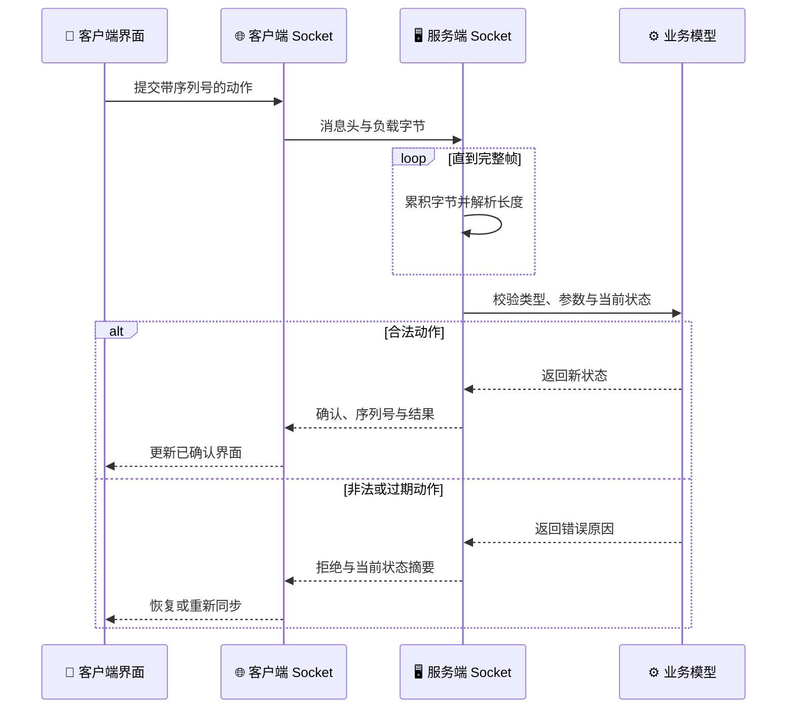

# Week 2 — Socket 与并发编程学习指南

*本指南依据目录中的 2013—2017 年考试题、参考源码、2016 年网络五子棋和 2017 年国际跳棋大作业整理，目标是把网络通信、并发计算与联网应用设计串成一条完整学习路线。*

---

## 📋 资料画像

这个目录包含 283 个文件，主体是 Qt 4/Qt 5 时代的 qmake 工程与课程文档：51 个 `.cpp`、31 个 `.h`、19 个 `.ui`、17 个 `.pro`、7 份 PDF、3 份旧版 Word 文档、3 份 PPTX，以及若干资源和归档文件。

| 内容 | 主要材料 | 学习价值 |
|---|---|---|
| 历年考试 | 2013—2017 年题目 | TCP/UDP、线程、文件传输、Web 与协议设计 |
| 参考实现 | 2015—2017 年 Qt 工程 | 从信号槽追踪真实网络事件和线程协作 |
| 2016 大作业 | 网络五子棋 | 联网棋盘、回合同步、胜负判断与请求协商 |
| 2017 大作业 | 国际跳棋 | 复杂规则、DFS、多段吃子、状态同步与音效 |
| 优秀作业 | 五子棋与两套国际跳棋实现 | 比较不同界面、协议和算法架构 |
| 压缩归档 | 考试提交与原始作业包 | 留档用途，通常不是首选阅读入口 |

> `hw/2016/greatwork/chatserver` 和 `chatclient` 的实际内容是网络五子棋，不是普通聊天室。2017 年项目是 **国际跳棋（Draughts）**，也不是六角星棋盘的中国跳棋。

根目录原先没有总说明；`hw/readme.md` 中的历史链接已原样保留。

## 🎯 学完后应具备的能力

学生应能独立完成以下事情：

1. 解释 IP、端口、客户端、服务器、连接、监听和会话的关系。
2. 使用 `QTcpServer`、`QTcpSocket` 与 `QUdpSocket` 完成双向通信。
3. 正确处理连接建立、数据到达、断线、错误和资源回收等异步事件。
4. 自行设计有版本、类型、长度和负载的应用层协议，并解决 TCP 粘包与拆包。
5. 使用 `QThread` 或工作对象组织并发任务，安全处理共享数据和线程退出。
6. 实现分块文件传输、进度显示、头信息解析、并发控制和失败恢复。
7. 编写一个最小 HTTP 服务器，理解请求行、响应头和响应体。
8. 将联网棋类的规则引擎、界面、网络会话和资源播放分开。
9. 为丢包、断线、重复消息、非法输入、并发竞争和双方状态不一致设计测试。

## 📚 历年考试知识主线

| 年份 | 第一题 | 第二题 | 第三题 |
|---|---|---|---|
| [2013](exam/Socket2013.doc) | 远程漫步：批量发送鼠标路径，服务端绘制点与箭头线 | 三线程并行统计指定 `key` 范围内最小的三个 `value` | TCP 网络令牌：线程服务客户端，互斥保护令牌和用户队列 |
| [2014](exam/Socket2014.doc) | 远程读取文件：`f/l/q` 命令与会话状态 | 三个生产者/消费者缓冲区、互斥锁、事件和结束哨兵 | 聊天中转：用户名到 Socket 映射，客户端收发线程，服务端 `select` 复用 |
| [2015](exam/2015/Socket2015.pdf) | 远程绘图：传输圆、矩形、三角形参数 | 四工作线程按 `key % 4` 分类并归并排序 | UDP 发下载请求、TCP 反向传文件，五任务进度与多客户端并发 |
| [2016](exam/2016/Socket2016.pdf) | 控制台发送圆心和半径，服务端绘制最新圆形 | `QThread` 完成四段排序、两段合并和最终合并 | 解析浏览器 `GET` 请求并返回 HTML 的最小 Web 服务器 |
| [2017](exam/2017/Socket-2017.doc) | UDP 远程手写：发送 `(x, y, b)` 并重建连续笔画 | 五线程分段车牌，再按尾号模 5 并行归并与输出 | 两客户端经服务器离线中转文件，支持双向并发和传输头 |

从这些题目可以看出三条持续加深的主线：

- 网络从单次参数传输发展到长连接、会话、文件和游戏协议
- 并发从分段计算发展到生产者/消费者、事件同步和双向传输调度
- 界面从显示网络结果发展到维护可恢复、可验证的分布式应用状态

## 🌐 Socket 核心知识体系

### 网络地址与角色

- `QHostAddress` 表示本机、环回或远程地址，端口标识同一主机上的服务入口。
- 服务端执行监听并接收连接；客户端主动连接。建立连接后，通信双方都能发送和接收。
- `QHostAddress::LocalHost` 只适合本机测试，`QHostAddress::Any` 才表示监听可用网络接口。
- 使用 `QNetworkInterface` 或主机信息时，要区分环回、局域网、IPv4、IPv6 和不可达地址。
- 端口可能被占用或受权限、防火墙影响，必须处理 `listen()`、`bind()` 和连接失败。

### Qt TCP 服务端

基本生命周期是：

1. 创建 `QTcpServer` 并调用 `listen()`。
2. 响应 `newConnection`，循环取出所有 `nextPendingConnection()`。
3. 为每个 `QTcpSocket` 连接 `readyRead`、`disconnected` 和错误信号。
4. 在接收缓冲区中解析完整协议帧，再交给业务模型。
5. 断线后移除会话、关闭文件、释放 Socket，并通知业务层。

服务器必须明确是只服务一个连接、事件驱动管理多个连接，还是为连接建立独立工作线程。三者的数据结构和退出方式不同。

### Qt TCP 客户端

- 使用 `connectToHost()` 建立连接，并根据 `connected`、断线和错误信号更新界面状态。
- 发送按钮不能仅因为调用了 `write()` 就认为操作完成；还要区分写入本地缓冲、对端收到和业务确认。
- 不在界面线程中长期使用 `waitForConnected()`、`waitForReadyRead()` 或休眠等待。
- 建立连接、正在认证、空闲、发送中、等待确认、断线重连等状态应显式建模。

### TCP 是字节流

这是本目录最重要的知识点。一次 `write()` 不对应一次 `readyRead()`：一条消息可能分多次到达，多条消息也可能一次到达。参考源码中常见的“`readAll()` 后立即把它当成一条完整命令”只适合非常受控的演示，不能作为可靠协议。

建议每个消息帧至少包含：

| 字段 | 作用 |
|---|---|
| 协议版本 | 支持双方升级与兼容判断 |
| 消息类型 | 区分落子、文件头、文件块、确认和错误 |
| 请求或序列号 | 去重、排序并关联响应 |
| 负载长度 | 判断接收缓冲区是否已有完整帧 |
| 负载 | 坐标、棋盘动作、文件数据等实际内容 |
| 校验信息 | 文件或关键消息的完整性检查 |

接收端要保留未解析字节，只有“头完整且负载长度满足”时才消费一帧，并继续检查缓冲区中是否还有下一帧。

### UDP 数据报

- `QUdpSocket::bind()` 接收数据报，`writeDatagram()` 向指定地址和端口发送。
- 用 `pendingDatagramSize()` 为每个数据报分配缓冲，再读取发送者地址、端口和内容。
- UDP 保留单个数据报边界，但不保证到达、顺序或只到达一次。
- 远程手写若要求轨迹稳定，应为点加入笔画编号、序列号和开始/结束标志，并决定丢点如何处理。
- 小型实时位置消息可以接受偶发丢失；文件、关键落子和协商消息则需要确认、重传或直接使用 TCP。

### 序列化与协议设计

- `QByteArray` 是网络字节容器，`QDataStream` 可序列化整数、字符串等类型。
- 通信双方应约定 `QDataStream` 版本、整数宽度、字节序、字符串编码和最大长度。
- 文本协议易调试，但必须有明确分隔、转义和长度限制；二进制协议紧凑，但需要更严格的结构说明。
- 不信任网络输入：坐标、文件名、大小、路径长度、消息类型、回合方和棋盘动作都要验证。
- 协议文档至少要给出字段表、状态图、正常示例、错误响应和版本兼容规则。

### 文件传输与简单 HTTP

文件传输应掌握：

- 先传受限长度的文件名、文件总大小和传输标识，再分块发送文件内容
- 根据实际确认的字节数更新进度，处理部分写入、断线、磁盘错误和取消
- 接收文件时先写临时目标，完整性验证成功后再作为正式文件使用
- 限制文件大小并清理文件名，禁止通过 `../` 或绝对路径越过允许目录
- 双向中转时为每个会话保存方向、阶段、剩余字节和排队状态

最小 HTTP 服务还应理解请求行、头部结束标志 `\r\n\r\n`、状态码、`Content-Length` 的字节含义、内容类型和连接关闭。目录中的 2016 示例适合观察基本流程，但它对请求解析、路径校验、错误响应和多连接处理做了大量简化。

## 🔄 并发与线程知识体系

### 任务分解与依赖

- 先区分 CPU 密集型任务和 I/O 密集型任务，再决定是否增加线程。
- 2013 题把数据段分给三个相同工作函数，主线程归并局部结果。
- 2016 归并排序参考实现先启动四个排序线程，再启动两个合并线程，最后启动一个总合并线程。
- 2017 车牌题先形成 5×5 个局部队列，再由五个线程分别合并一个余数类别。
- 只有数据分区互不重叠时才能无锁并行；共享结构仍需同步。

### `QThread` 的两种使用方式

1. 继承 `QThread` 并重写 `run()`：适合边界清楚、无复杂事件循环的计算任务。
2. 将工作 `QObject` 移入线程：适合需要槽函数、计时器或异步 Socket 的长期工作对象。

无论采用哪种方式，都应通过信号把结果送回界面线程。不要从工作线程直接修改控件，也不要在错误的线程中操作已经绑定到其他线程的 Socket。

### 同步原语与生产者/消费者

- `QMutex` 或标准互斥量保护共享不变量，而不是随意包住整个耗时函数。
- 条件变量适合“缓冲区为空时等待、加入数据时唤醒”，优于反复休眠轮询。
- 信号量适合表示有限资源数量，例如下载槽位或令牌数量。
- 原子变量只适合简单状态和计数，不能替代对复合队列的一致性保护。
- 结束标志、关闭队列或哨兵值都可以终止消费者，但必须防止提前退出和遗漏数据。

### 线程生命周期

- 明确所有线程由谁创建、何时停止、谁等待结束以及谁释放对象。
- 窗口关闭前应发出取消请求，停止接收新任务，并等待工作线程有界退出。
- 使用 `finished` 信号组织阶段依赖时，要防止重复启动同一线程对象。
- 超时不是同步机制；`sleep()` 只能模拟延迟，不能证明数据已经准备好。
- 所有共享状态都要能说明其所有者、读写线程和同步策略。

## 🔗 客户端与服务器通信流程

下图给出一个比历史示例更稳健的 TCP 消息生命周期。关键不是“收到字节”，而是“积累出完整帧、验证业务状态、返回可关联的确认”。

实现时还应补充：连接超时、心跳、断线重连、重复请求去重、协议版本不兼容和会话结束。棋类程序尤其要避免两端都先修改棋盘、随后才发现对方拒绝动作。

## 📦 综合大作业主线

### 2016 网络五子棋

[大作业说明](hw/2016/大作业2016.pptx)要求只用 `QTcpServer` 和 `QTcpSocket` 完成网络五子棋。学生应掌握：

- 主机创建、客户端加入、连接取消和双方准备流程
- 15×15 棋盘坐标映射、合法落子与横竖斜四方向五连判断
- 每步落子后发送协议消息、切换回合并同步棋盘
- 每步 20 秒倒计时、超时放弃落子机会和双方总用时统计
- 认输/退出协商、最多连续两步悔棋且必须获得对方同意
- 胜负音效、断线状态和按保存时间恢复残局
- 设计文档中的双方流程、通信协议和网络编程框架

优秀作业参考实现使用整数文本编码传递控制类型与坐标，并加入危险点提示。阅读时应重点思考：如果两条落子消息在 TCP 中合并到达，现有 `readAll().toInt()` 会发生什么，以及如何把它改为有长度的消息帧。

### 2017 国际跳棋

[大作业说明](hw/2017/大作业.pptx)、[规则](hw/2017/跳棋游戏规则.pdf)和[评分说明](hw/2017/第二周大作业评分标准说明.pdf)共同要求实现 10×10、双方各 20 子的联网国际跳棋。

规则引擎至少要正确处理：

- 只有 50 个黑格属于有效棋位，普通棋子通常向前斜走一格
- 有吃子机会时必须吃；有多条路线时必须选择吃子数最多的路线
- 连续吃条件仍成立时必须继续，整轮结束后才统一移除被吃棋子
- 普通棋子吃子时可前后跳，王可以沿对角线远距离移动和吃子
- 棋子仅在一轮结束时停在对方底线才加冕；经过底线但继续跳走不能立即成为王
- 一方无棋或无任何合法动作时判负
- 认输、求和、音效以及单局网络对战
- 自定义棋局导入，能够复现任意合法测试局面

两套优秀实现展示了不同思路：

| 实现 | 结构特点 | 值得研究 |
|---|---|---|
| 张益玮 | `Cell` 控件、10×10 数组、`Move` 路径记录 | DFS 枚举连跳、全局最多吃子、自定义棋盘、求和协议 |
| 李玮祺 | 网络、棋局、动画、音乐分文件 | 50 棋位映射、DFS 路线、单字符命令、GIF/BGM 反馈 |

真正可靠的实现应让纯规则引擎接收“棋盘 + 当前方”，返回完整合法动作集合；界面只负责展示候选动作，网络层只传输选中的动作和确认结果。

## 🔍 测试与调试重点

### 网络测试矩阵

| 场景 | 必须验证 |
|---|---|
| 连接 | 错误 IP、端口占用、拒绝连接、连接后立即断开 |
| TCP 输入 | 半个头、半个负载、两帧合并、超长帧、未知类型 |
| UDP 输入 | 丢包、乱序、重复、过大数据报、错误发送者 |
| 文件 | 空文件、大文件、同名文件、磁盘满、取消、断点与校验失败 |
| 并发 | 同时连接、同时发送、关闭窗口、任务超时、线程竞争 |
| 游戏 | 非己方回合、非法坐标、重复动作、断线重连、状态摘要不一致 |

### 并发计算验证

- 把单线程正确结果作为基准，与多线程结果逐项比较。
- 测试数据量小于线程数、不能均分、空输入、重复值和极端值。
- 在不同调度顺序下重复执行，检查是否出现偶发错误。
- 使用明确的阶段计数或任务依赖，不能靠固定等待时间推测其他线程完成。
- 对共享队列记录生产、消费和剩余数量，检查每条数据恰好处理一次。

### 棋类规则验证

2017 评分材料特别提供了自定义棋局来检查“只能走吃子最多的棋”“连续吃”“王的远距离吃子”“被跳过棋子在整轮结束前仍构成屏障”等细节。应把这些局面转成规则引擎的自动测试，而不只靠人工点击。

推荐为每个动作测试：起点、完整路径、被吃集合、升王结果、下一回合、结束判定，以及序列化后由另一端重放是否得到完全一致的棋盘。

## ⚠️ 阅读历史代码时的注意事项

- 工程主体使用 Qt 4/Qt 5、qmake 和旧式 `SIGNAL()`/`SLOT()` 宏。要能读懂，新代码则宜使用类型安全的连接方式。
- 多个示例把一次 `readyRead` 当作一条完整 TCP 消息，缺少接收缓冲、长度帧和上限校验。这是最需要主动修正的地方。
- 部分文件传输参考代码使用很短的阻塞等待，并假定一次 `readAll()` 就是预期数据；真实网络下可能截断、合并或超时。
- 2016 Web 示例只做了最小 `GET` 处理，对非法请求、路径穿越、内容类型和并发连接都不完整，不能直接暴露到公共网络。
- 一些项目使用裸指针、动态分配后未释放、嵌套事件循环或界面线程等待。应使用清晰所有权、RAII、异步信号和可取消任务。
- 李玮祺作业中存在 `[本地路径已移除]` 之类绝对资源路径；移植时应改用 `.qrc` 或相对配置。
- 参考实现中存在只适合现场演示的端口、环回地址和边界假设，甚至有未初始化变量等明显风险。优秀作业也应当审阅，而不是当作标准答案照抄。
- `exam/2016/tmp.zip` 含大量原始提交和构建产物；压缩包、`.gch`、生成的 `ui_*.h`、缓存和无扩展名二进制主要用于留档，不是首选学习材料。
- 不要运行来源不明的归档内程序。分析源码时也只在本机环回或隔离网络上测试文件服务和 Web 服务。

## 🏁 建议顺序与掌握自检

### 建议阅读顺序

1. 阅读 2016 第一题的 TCP/UDP 小工程，跑通地址、端口、连接和数据到达。
2. 阅读 2017 第一题，独立实现带笔画编号的 UDP 远程绘图。
3. 完成一个有长度帧的 TCP 聊天或命令协议，主动测试拆包与粘包。
4. 阅读 2016 第二题和 2017 第二题，比较分段计算与两阶段归并。
5. 阅读 2016 第三题，重写为能够返回正确错误码并限制文件目录的小型 HTTP 服务。
6. 阅读 2015 与 2017 文件传输题，实现分块、进度、取消和完整性校验。
7. 阅读 2016 网络五子棋，把协议、棋盘模型与界面拆开。
8. 最后阅读 2017 国际跳棋，先完成纯规则引擎和测试，再接网络与动画。

### 最小实践作品集

建议至少独立完成：TCP 帧协议回显程序、UDP 远程画板、多线程归并排序、最小静态 HTTP 服务、可取消的分块文件传输，以及一个服务器裁决的联网棋盘游戏。

### 掌握情况自检

- [ ] 我能解释 TCP 字节流为什么会拆包或粘包，并写出持续解析缓冲区的代码。
- [ ] 我能说明 UDP 适合远程轨迹却不适合直接承载关键文件数据的原因。
- [ ] 我能完成 `QTcpServer` 和多个 `QTcpSocket` 的连接生命周期管理。
- [ ] 我能为协议定义版本、类型、序列号、长度、负载和错误响应。
- [ ] 我能验证所有网络输入，并限制内存、文件大小、路径和坐标范围。
- [ ] 我能区分计算线程与 I/O 线程，并保证工作线程不直接修改界面。
- [ ] 我能使用互斥量和条件变量实现无忙等的生产者/消费者队列。
- [ ] 我能正确停止线程和 Socket，不留下仍在运行的后台对象。
- [ ] 我能分块传输文件并处理部分到达、进度、取消、断线和校验失败。
- [ ] 我能构造合规的最小 HTTP 响应，并拒绝越界路径和非法请求。
- [ ] 我能把五子棋或国际跳棋规则写成不依赖 Qt 控件的纯模型。
- [ ] 我能为国际跳棋枚举完整连跳路径并执行“最多吃子”规则。
- [ ] 我能用自定义局面、断线和重复消息测试双方最终状态一致。
- [ ] 我能指出历史示例中的协议、线程、所有权和可移植性风险。

最终目标不是只让两台机器“偶尔连得上”，而是能够明确回答：**消息边界在哪里、状态由谁裁决、失败如何恢复、线程何时结束，以及双方为什么最终仍然一致。**
