# Week 3 · Python 学习指南

*依据 2012—2017 年考试题、2015—2017 年大作业说明及目录内代表性代码整理；用于贯通知识与安排学习，不作为标准答案。*

---

## 📋 资料定位

本目录的核心不是单独学习几条 Python 语法，而是完成一条完整的软件开发链路：**命令行程序 → 文件与结构化数据 → 网页解析与爬虫 → 倒排索引 → Django Web 系统 → 安全、测试与性能**。

| 资料 | 主要内容 | 使用方式 |
|---|---|---|
| [`exam`](exam/) | 2012—2017 年试题、输入数据和部分历史实现 | 以试题文档为要求基准，代码用于比较方案与发现问题 |
| [`hw/2015.ppt`](hw/2015.ppt) | 基于 Django 的美食检索系统 | 入门英文网页爬取、分词、倒排索引和多词查询 |
| [`hw/2016/2016.ppt`](hw/2016/2016.ppt) | 清华新闻网信息检索系统 | 进阶中文分词、时间筛选、摘要、高亮和分页 |
| [`hw/2017/2017.ppt`](hw/2017/2017.ppt) | 人物信息检索系统 | 万级页面、Infobox 结构化抽取、字段检索与相关性排序 |
| [`hw/2016/lzl`](hw/2016/lzl/) 与 [`hw/2016/lyw`](hw/2016/lyw/) | 两份新闻检索项目样例 | 阅读数据流和工程拆分，不应直接当成现代项目模板 |

目录共有 1776 个文件、168 个子目录，约 122 MiB。数量较多主要是因为包含了成套 Django/Qt 离线文档、生成页面、测试数据及提交产物；学习时不必逐文件阅读。`exam/2016/docs` 与 `exam/2017/1` 下的大量参考文档只需按问题查阅。

## 🎯 学完应达到的能力

完成本单元后，学生应能独立做到：

- 用现代 Python 3 编写可复用的命令行程序，正确处理参数、异常、编码、路径和边界输入。
- 递归遍历目录，按文件名、类型、大小、目录总大小和正文关键词完成检索。
- 读写文本、CSV、JSON、XML、XLSX，并理解 PDF 是版面格式，抽取时需要重建阅读顺序和表格结构。
- 从 HTML 页面稳定抽取字段，处理缺失值、重复项、空白、链接和不规则表格。
- 编写有边界、有节制、可恢复的爬虫，并为页面分配稳定且唯一的文档 ID。
- 完成分词、倒排索引、多关键词布尔查询、字段筛选、排序、分页、摘要和高亮。
- 用 Django 组织 URL、视图、模板、模型、表单、迁移、ORM 查询、CRUD、会话与权限。
- 用安全方式处理算术表达式、序列化数据和用户密码，并为核心逻辑编写自动化测试。
- 把采集、解析、索引和展示拆成清晰模块，说明数据流、复杂度、失败处理及性能瓶颈。

这里的“掌握”至少包括四层：能解释原理、能从零实现、能用测试证明正确、能指出历史实现的风险并改进。

## 📚 历年考核主线

| 年份与原题 | 编程题 | 数据处理题 | Web 题 | 应掌握的核心 |
|---|---|---|---|---|
| [2012](exam/python2012.doc) | 偶数、完全平方数、交集与并集 | 从个人主页抽取姓名、职称、入职时间、联系方式、照片编号等字段 | 按姓名、职称、入职时间组合查询教师 | 集合运算、目录遍历、HTML 字段抽取、组合筛选 |
| [2013](exam/python2013.doc) | 求一元二次方程的实根、重根或复根 | 抽取清华历任校长及任期 | 按姓名、年、月组合查询 | 表达式解析、`cmath`、文本规范化、日期筛选 |
| [2014](exam/python2014.doc) | 找出出生于闰年的学生 | 抽取 QS 排名中的学校、国家、名次和分数 | 按学校、国家、名次、分数阈值查询 | 日期规则、HTML 表格、数值比较、缺失字段处理 |
| [2015](exam/2015/python2015.doc) | XML 与 JSON 双向转换 | 抽取国家、首都、人口和面积并支持查找 | 浏览器/服务器计算器 | 数据模型映射、表格抽取、HTTP 表单、安全表达式求值 |
| [2016](exam/2016/python2016.doc) | 按大小、类型或多个正文关键词递归找文件 | 从 PDF 提取表格并输出 CSV/XLSX | 可按内容和分钟级时间增、查、删的网络记事本 | 文件系统、PDF 版面、表格输出、Django ORM 与 CRUD |
| [2017](exam/2017/python2017.doc) | 按文件名长度、文件大小或目录总大小筛选 | 汇总四份计算机学科排名 | 注册、登录、管理员/普通用户权限 | 递归聚合、实体对齐、区间名次、认证、授权与数据保护 |

历年题目的递进规律很稳定：先写一个确定性的 Python 小程序，再把半结构化资料变成干净数据，最后通过 Django 提供查询或管理界面。复习时应贯通三部分，而不是把它们当成互不相关的题型。

## ⚙️ Python 基础与算法

### 语言与程序结构

- 熟练使用字符串、数字、布尔值、列表、元组、集合、字典，以及切片、推导式、排序和解包。
- 理解可变/不可变对象、引用与复制、哈希与去重；能说明集合交并运算为何适合多关键词检索。
- 用函数、模块和类划分职责，避免把解析、存储、查询和页面逻辑堆在同一个文件中。
- 使用上下文管理器读写文件，针对预期错误捕获具体异常，并给出可理解的错误信息。
- 使用 `argparse` 定义命令、参数类型、默认值和帮助信息；不要依靠裸 `sys.argv` 加一个总括异常处理。

### 数学、日期与安全求值

- 正确实现闰年规则：能被 400 整除，或能被 4 整除但不能被 100 整除。
- 求解一元二次方程时处理退化的一次方程、判别式为零、实根与复根，并考虑浮点误差。
- 对“任意项顺序、等号两边均可有项”的方程先做词法/语法解析和系数归一化，不能靠脆弱的字符串替换。
- 计算器只允许数字、括号和白名单运算符；应自行解析或使用受限语法树，绝不能对用户输入直接调用 `eval`。

### 复杂度与可测试性

- 能分析一次目录遍历的时间复杂度，以及重复扫描全文、反复构造大集合和线性查表的代价。
- 把纯计算与文件/网络访问分离，让闰年判断、区间名次换算、字段清洗、查询集合运算可以单独测试。
- 为正常值、空输入、非法值、边界值、编码错误、无权限文件和损坏数据准备测试用例。

## 🔍 文件、格式与网页解析

### 文件系统

- 使用 `pathlib` 或 `os.walk` 递归遍历；区分文件、目录、符号链接与其他对象，并处理权限错误和链接循环。
- 文件名长度只计算名称还是包含扩展名，必须先定义清楚；扩展名比较应统一大小写。
- 文件大小来自单个文件的元数据；目录大小需要递归汇总其后代文件，并明确是否计入链接目标和重复文件。
- 正文搜索要区分文本与二进制文件，显式处理编码，并支持“同时包含全部关键词”等清晰语义。

### 结构化与半结构化格式

| 格式 | 必须掌握 | 常见陷阱 |
|---|---|---|
| JSON | 对象、数组、字符串、数值、布尔值、空值及 UTF-8 读写 | 键类型受限、日期没有原生类型、不要把 JSON 文件当 Python 表达式求值 |
| XML | 元素、属性、文本、命名空间、顺序与重复子节点 | XML 与 JSON 并非天然一一对应，转换规则必须写清楚并验证往返结果 |
| HTML | DOM 树、CSS 选择器、链接解析、实体与空白规范化 | 不要用一条正则表达式解析整份 HTML；页面结构变化和缺失字段必须可容错 |
| CSV/XLSX | 表头、列类型、引号、换行、空值、工作表 | CSV 不是简单用逗号拼接；Excel 日期和数值显示不等于底层值 |
| PDF | 页面、文本框、坐标、阅读顺序、跨页表格 | 抽出文字不代表恢复了表格；扫描版还需要 OCR，并应抽样核对原页面 |

### 清洗、对齐与排名汇总

- 将抓取结果先映射为明确的数据模型，保存来源 URL、抓取时间和原始值，再生成清洗值。
- 统一空白、大小写、标点、别名和学校名称后再去重；不能用随意截断逗号或括号代替实体对齐规则。
- 对 `51–75` 一类区间名次按题意换算为端点平均值 63；对并列、缺榜和不同榜单规模制定一致政策。
- 输出前检查字段数、类型、唯一键、缺失率与记录总数，并抽样回查原网页或原文档。

## 🌐 爬虫、检索与 Django

### 爬虫与解析管线

- 从种子 URL 出发，用队列完成 BFS/DFS；规范化相对链接、片段、查询参数和重复 URL，并把“已发现”与“已成功抓取”区分开。
- 设置明确的作用域、User-Agent、超时、有限重试、请求间隔和失败日志；只采集获准访问的内容，并遵守站点规则。
- 检查状态码、内容类型和编码；原始页面与结构化结果分开保存，使解析器可以离线重跑。
- 用 DOM 解析器定位标题、正文、时间、链接或 Infobox；为模板变化、缺字段、重定向和重复页面准备降级逻辑。

### 分词、倒排索引与查询

- 文档 ID 必须唯一、稳定，并能反查原始 URL；索引的基本结构是 `词项 → 文档 ID 集合/有序表`。
- 中文文本需要分词和停用词策略，英文文本需要大小写、标点及词形规范化；标题和正文可以保存不同权重。
- 多词 AND 查询使用文档集合交集，OR 查询使用并集；先从最短倒排表开始相交可减少中间结果。
- 进一步实现字段检索、时间筛选、全匹配优先、部分匹配降级、分页、上下文摘要和安全高亮。
- 能解释全量重建、增量更新、索引持久化和并发读取之间的取舍，并用真实数据测量索引时间、大小与查询延迟。

### Django Web 开发

- 理解 Django 的 MVT：URL 负责路由，View 处理业务，Template 负责展示，Model/ORM 管理数据；课件所称 MVC 可按这一对应关系理解。
- 会创建项目与应用，配置 URL、模板与静态资源，定义模型和迁移，并用 QuerySet 完成组合筛选及 CRUD。
- 区分 GET 查询与 POST 修改；使用 Django Form 做类型转换和校验，所有修改请求都要有 CSRF 防护。
- 使用模板自动转义，若要高亮搜索词，应先转义原文再插入受控标记，避免 XSS。
- 注册和登录应使用 Django 认证系统及密码哈希；权限必须在服务端检查。任何角色都不应看到明文密码，管理员也不例外。
- 用 Django 测试客户端覆盖页面状态码、表单错误、组合查询、增删操作、登录状态和越权访问。

## 🔗 全阶段学习路线

```mermaid
flowchart LR
    accTitle: Week 3 Python 全阶段学习路线
    accDescr: 从 Python 基础和命令行开始，依次掌握文件与数据格式、网页解析、爬虫、倒排索引、Django、安全测试，最后完成综合检索系统。
    python_base["Python 基础与命令行"] --> files_data["文件与数据格式"]
    files_data --> html_parse["HTML 与 PDF 解析"]
    html_parse --> crawler["受控网页采集"]
    crawler --> inverted_index["分词与倒排索引"]
    inverted_index --> django_web["Django 查询与 CRUD"]
    django_web --> security_test["认证、安全与测试"]
    security_test --> capstone["综合信息检索系统"]
```

建议每一阶段都保留一个可运行的小作品：命令行文件搜索器、格式转换器、离线网页抽取器、小型索引器、Django 记事本，最后再组合为检索系统。这样发生错误时可以定位到具体层，而不是在一个庞大项目里同时调试所有问题。

## 📦 三届综合大作业

| 年份 | 数据与规模 | 必做能力 | 进阶方向 |
|---|---|---|---|
| [2015](hw/2015.ppt) | 维基美食，至少两类、超过 200 个页面 | 页面抓取、正文清洗、文档 ID、倒排索引、多词全包含查询、Django 模板 | 分类筛选、CSS/JS、分页 |
| [2016](hw/2016/2016.ppt) | 清华新闻，超过 500 个页面 | 标题/正文/时间抽取、`jieba` 分词、中文倒排索引、多词 AND 查询、Django 展示 | 时间筛选、摘要、高亮、分页、更多文档类型 |
| [2017](hw/2017/2017.ppt) | 维基人物 Infobox，至少 10000 人 | 全字段抽取、唯一 ID、字段值索引、人物详情页、全匹配优先且保留部分匹配 | 多字段查询、摘要、高亮、分页 |

三届作业不是三个孤立项目，而是同一系统逐年提高数据规模、语言处理难度、结构化程度和检索质量。一个合格的最终项目应至少包含：

1. 可重复运行的采集或离线导入程序，以及小规模示例数据。
2. 明确的数据模型和清洗规则，原始数据与派生索引分离。
3. 可重建的倒排索引，以及单词、多词、无结果、特殊字符查询测试。
4. Django 搜索页、结果页和详情页，具备分页、错误提示与基本样式。
5. 性能记录。课件以约 1 秒查询响应作为课程目标，同时分别提出 200、500、10000 页的规模要求。
6. README、依赖说明、启动步骤、功能截图、已知限制和测试方法。

## ⚠️ 历史代码阅读须知

这些资料保留了当时的教学环境和学生提交，适合研究思路，但不宜不加辨别地直接运行或复制：

- 代码混有 Python 2 写法，如 `urllib2`、`Queue`、`cPickle`、`file()`、`dict.has_key()` 和旧式 `print`；Django 项目也可见 1.10/1.11 时代接口。学习实现应迁移到现代 Python 3 与受支持的依赖。
- 个别计算器、排名解析和索引读取代码使用 `eval`。用户输入绝不能交给 `eval`；字面量可用受限解析，持久化数据优先使用 JSON 或数据库。
- 不应加载来源不可信的 Pickle 文件；反序列化可能执行任意代码。即使扩展名是 `.pkl`，也要先确认实际格式和来源。
- 全局变量保存用户状态、在请求中改写模板文件、调用系统命令、裸 `except`、硬编码路径或记录范围，都可能造成并发、注入、可移植性和排错问题。
- 2017 年试题第三题是用户注册与权限管理，但随附 `exam/2017/3/calc` 示例并非对应实现；`hw/2016/lyw` 的说明还引用了当前目录中缺失的爬虫/索引脚本。应以试题和 PPT 为要求基准，把样例视为不完整材料。
- 历史题要求普通用户查看自己的“用户名和密码”，现代实现只能显示账号资料，不能存储、回显或让管理员读取明文密码。
- 旧网址、页面结构和第三方前端资源可能已经失效。优先用目录内快照或自己保存的小样本验证解析器，再在获准范围内测试网络采集。

## 🏁 建议顺序与验收标准

### 第一阶段：基础与文件

1. 完成 2012 集合题、2013 方程题、2014 闰年题。
2. 写一个统一的文件搜索命令，覆盖 2016/2017 的大小、类型、名称、正文与目录聚合条件。
3. 用临时目录自动生成边界数据，验证空目录、中文名、无权限文件和二进制文件。

### 第二阶段：数据抽取

1. 分别从本地 HTML 表格和详情页抽取记录，输出带表头的 CSV/JSON。
2. 实现 XML/JSON 映射规则，并测试属性、重复子节点、空值和 Unicode 的往返结果。
3. 从 PDF 抽取表格后抽样对照原页，记录不能可靠恢复的单元格。

### 第三阶段：搜索内核

1. 为一批离线 HTML 建立稳定 ID、结构化文档表和倒排索引。
2. 实现 AND、OR、全匹配优先、字段筛选和时间筛选，并解释集合运算复杂度。
3. 测量建索引时间、索引大小、单词与多词查询延迟，不能只凭页面“看起来能用”判断性能。

### 第四阶段：Django 与综合项目

1. 先完成记事本 CRUD，再接入搜索索引；页面逻辑、查询逻辑和存储逻辑分层。
2. 增加注册、登录、角色权限、CSRF、防 XSS、表单校验和错误页。
3. 用自动化测试证明未登录、普通用户和管理员只能执行各自被授权的操作。
4. 从三届大作业中选择一个主题，完整交付采集、解析、索引、搜索、详情、测试和文档。

最终自检：如果你能在不参考历史答案的情况下完成上述四阶段，并能说明为什么不用正则解析整页 HTML、为什么不用 `eval`/不可信 Pickle、为什么不能保存明文密码，以及倒排索引为何比逐文档扫描更适合检索，就达到了本目录要求的核心水平。
