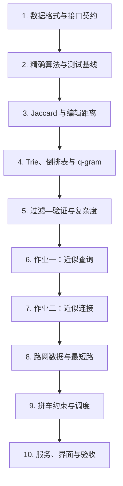

# 数据库专题训练：学习指南

*依据目录内 2018 年题面、框架代码、样例数据、参考实现与设计报告整理；原始归档保持不变。*

---

## 📋 课程定位与资料地图

这组材料的主题是“数据库新型检索技术”的工程训练，主线是**相似性检索 → 相似连接 → 路网出行查询系统**。它训练的是数据检索算法、索引、过滤—验证框架、图上最短路与系统集成，并不是一套关系数据库或 SQL 入门课；现有资料也没有系统覆盖关系模型、SQL、事务、并发控制和恢复机制。

| 阶段 | 任务与交付 | 题面及框架 | 归档参考实现 |
| --- | --- | --- | --- |
| 样例 | 核对近似查询的输入、排序和阈值语义 | [样例与说明](hw/2018/sample_11008199.zip) | — |
| 作业一 | 为单个字符串查询返回所有满足阈值的记录 | [近似查询题面与框架](<hw/2018/作业一  近似查询/作业一_近似查询.zip>) | [SimSearcher 提交包](<hw/2018/作业一  近似查询/upload-SimSearcher.rar>) |
| 作业二 | 在两个文件间找出全部相似记录对 | [近似连接题面与框架](<hw/2018/作业二  近似连接/作业二_近似连接.zip>) | [SimJoiner 提交包](<hw/2018/作业二  近似连接/upload-SimJoiner.rar>) |
| 大作业 | 在真实规模路网上完成拼车候选查询与界面展示 | [互联网出行题面与数据](<hw/2018/大作业  互联网出行/大作业_互联网出行.zip>) | [完整历史提交包](<hw/2018/大作业  互联网出行/upload-917009493_3_大作业_互联网出行.rar>) |

阅读顺序应以 ZIP 中的题面和接口为准，RAR 中的代码与报告用于理解一种实现思路、分析优化点和发现工程问题，不应直接当成唯一标准答案。

## 🎯 学完应掌握的能力

完成本专题后，学生应当能够：

- 把自然语言需求转成明确的数据格式、函数接口、阈值语义、排序规则和完整性约束。
- 正确实现集合 Jaccard 相似度与字符串编辑距离，并为小数据建立暴力枚举基线。
- 使用 Trie、哈希表、倒排表和 q-gram 组织索引，区分离线建索引成本与在线查询成本。
- 解释“过滤—验证”框架：先用必要条件生成无漏召回的候选，再对候选计算真实相似度。
- 将单条近似查询推广为跨数据集的相似连接，处理候选去重、结果排序和边界条件。
- 解析大规模图与车辆数据，使用最短路、预计算、剪枝和有限规模排列搜索完成出行查询。
- 把算法后端、TCP 消息、桌面前端和地图可视化连成可演示的系统。
- 用正确性、召回完整性、延迟、索引时间、候选规模和内存占用评价实现，而不只判断“能运行”。

## 📚 先修知识与工具

| 类别 | 开始作业前至少要会 | 在专题中继续深化 |
| --- | --- | --- |
| C++ | 文件输入输出、函数与类、`vector`、`set`、`unordered_map`、排序 | 指针与对象生命周期、缓存友好的数据布局、哈希冲突和内存估算 |
| 算法 | 集合、字符串、动态规划、二分查找、复杂度分析 | Trie、倒排索引、前缀过滤、分区索引、候选剪枝、图最短路 |
| 数学 | 集合交并、比例、上取整、三角不等式的基本直觉 | 从阈值推导必要条件，并证明过滤不会造成假阴性 |
| 工程 | Linux 命令行、Makefile、基础调试 | 性能剖析、离线预计算、网络通信、前后端协议与可复现实验 |

原始小作业环境是 Ubuntu、g++ 4.8、C++11；大作业还涉及 METIS/GTree、Linux Socket、Node.js、Electron 2.0 和百度地图 JavaScript API。学习算法时可使用现代工具链重做，但若要复现历史提交，应先隔离旧依赖并记录版本。

## 🔗 推荐学习顺序

不要一上来照抄归档优化代码。每个阶段都先写可验证的精确版本，再加入一种过滤或索引，并用同一测试集证明结果集合完全一致；这样才能判断优化是否引入漏答或重复结果。

## 🔍 作业一：近似查询

### 问题契约

输入文件每行是一条字符串记录，行号从 0 开始即记录 ID。`createIndex(filename, q)` 读取文件并建立索引；`searchJaccard` 和 `searchED` 分别返回满足阈值的 `<记录 ID, 相似度或距离>`，结果必须按 ID 递增、无重复且不得漏掉任何合法记录。

### 必须理解的两个度量

- **Jaccard 相似度**：先按空格把记录转成去重词集合，`J(A,B)=|A∩B|/|A∪B|`。要明确重复词、连续空格和空集合的处理约定。
- **编辑距离（ED）**：允许插入、删除、替换，最小操作数不超过阈值 `τ` 才命中。先实现完整动态规划，再加入长度差过滤和只计算主对角线附近 `2τ+1` 宽度的带状动态规划。

### 索引与候选生成

1. 为 Jaccard 查询建立“词项 → 记录 ID 列表”的倒排表，并为每条记录保存去重词集合或有序词 ID。
2. 为 ED 查询把字符串切成长度为 `q` 的 q-gram，建立“q-gram → 记录 ID 列表”的倒排表。
3. 从相似度阈值推导交集数量下界；若两串编辑距离不超过 `τ`，q-gram 的破坏数量也有上界，可据此得到共享 q-gram 的必要下界。
4. 归档实现用 Trie 定位倒排表，并采用类似 MergeOpt 的长短表策略：扫描较短倒排表计数，在较长表中二分查找，提前淘汰不可能达到下界的记录。
5. 对候选执行真实 Jaccard 或 ED 计算。过滤条件只允许产生假阳性，绝不能产生假阴性。

### 完成标准

- 先对照样例包中的明确答案；再用随机小数据与暴力枚举逐项比较 ID 和数值。
- 覆盖阈值为 0、阈值恰好等于边界、重复词、短于 `q` 的字符串、完全相同和完全不同字符串。
- 分别报告建索引时间、单次查询时间、候选数、验证数和内存；能够解释 `q` 太小或太大时的取舍。

## ⚙️ 作业二：近似连接

### 从查询到连接

输入变成两个字符串文件，目标是找出所有满足条件的 `(id1,id2)`。`joinJaccard` 返回相似度，`joinED` 返回编辑距离；结果必须按 `id1`、`id2` 递增且无重复。直接做两层循环可作为正确性基线，但不适合大数据。

### Jaccard 连接

归档方案先按全局词频为词项确定顺序，让稀有词优先；每个集合只为阈值决定的前缀建立或探测倒排表。学生应掌握：

- 为什么两个达到 Jaccard 阈值的集合，其有序前缀必然至少共享一个词。
- 如何联合使用长度过滤、前缀过滤和位置/重叠上界，进一步减少候选。
- 为什么多个前缀词可能生成同一记录对，以及应在何处去重并做一次精确验证。

### ED 连接

归档方案采用基于分区的方法：把被索引字符串尽量均匀切成 `τ+1` 段；若两串 ED 不超过 `τ`，至少有一段未被编辑破坏。随后按目标长度、分段编号和片段内容建立倒排索引，在查询串的合法窗口中执行 multi-match-aware 探测，最后用带状 DP 验证。

学生需要能说明分区法的鸽巢原理、长度范围 `[|Q|-τ, |Q|+τ]`、合法窗口边界的来源，以及哈希碰撞、极短字符串和重复候选的处理。最终应在多组阈值上与笛卡尔积基线比较，证明连接结果完整。

## 💾 大作业：互联网出行

### 数据与查询目标

题面数据是北京路网和出租车快照：

| 文件 | 规模 | 每条记录的含义 |
| --- | ---: | --- |
| `road.cnode` | 338,024 个节点 | 节点 ID、经度、纬度 |
| `road.nedge` | 440,525 条无向边 | 两端节点 ID、道路长度；首行给出节点数和边数 |
| `car.txt` | 100,000 辆出租车 | 车辆 ID、已有乘客数、车辆位置、各乘客目的地 |

给定新乘客的当前位置 `S` 和目的地 `T`，应在约 5–10 秒内返回不超过 5 辆仍有座位的车。车到 `S` 的距离不超过 10 km，原乘客与新乘客各自的绕路也都不超过 10 km。

题面定义：原路线最短送达距离为 `D1`，车辆接新乘客的距离为 `D2`，接人后送完所有乘客的最优距离为 `D3`，新乘客独自从 `S` 到 `T` 的最短路为 `D4`。必须同时满足：

- 原乘客绕路：`D2 + D3 - D1 ≤ 10 km`。
- 新乘客绕路：`D3 - D4 ≤ 10 km`。

### 算法主线

1. 严格解析节点、边和车辆文件，检查 ID 范围、边数、单位及图的连通性。
2. 先用欧氏距离完成可工作的简化版，再用路网最短路替换距离函数；两种模型不可混用。
3. 对每辆车预计算原有乘客的 `D1`。因为最多 4 个座位，可用 DFS/排列枚举求最优送达顺序，并以当前最优值剪枝。
4. 用车辆容量、到乘客距离和绕路上界过滤候选，再按明确的代价函数排序并取前 5。
5. 路网查询应从 Dijkstra 基线逐步升级到预处理索引。归档实现内嵌 GTree，调用 `tree.search`/`search_catch` 求最短路，并读取预计算的 `car.data`。
6. 输出车辆、接人点、送达顺序和路线；为前端定义长度明确、可校验、能处理半包/粘包的消息协议。

### 系统组成

归档实现使用 C++/Linux Socket 在本机 `10005` 端口提供服务，Electron 页面通过 TCP 请求，百度地图负责选点和路线展示。这一部分要掌握的是模块边界：**数据加载与预计算、查询算法、服务协议、界面呈现**应能分别测试，而不是把所有逻辑写在一个入口里。

## 📊 测试与性能方法

| 层级 | 正确性基线 | 必记指标 |
| --- | --- | --- |
| 相似度函数 | 手算样例和完整 DP | 数值、边界、单次计算耗时 |
| 近似查询 | 对每条记录暴力验证 | 索引时间、查询延迟、候选数、验证数、召回完整性 |
| 近似连接 | 两文件笛卡尔积 | 总记录对、候选对、去重前后数量、总耗时 |
| 最短路 | 小图手算或 Dijkstra | 距离一致性、预处理时间、查询时间、索引大小 |
| 拼车查询 | 小规模枚举全部车辆与送达顺序 | 返回数量、容量、三项 10 km 约束、排序稳定性、端到端延迟 |

性能优化必须有对照实验。至少保留“无索引/无过滤”的小数据基线，逐项加入长度过滤、前缀或分区过滤、倒排索引和预计算；每次记录候选缩减比例与结果集合是否完全相同。不要只给最终运行时间，因为那无法定位收益来自哪里。

## ⚠️ 历史归档使用提醒

- 小作业 ZIP 是题面与空框架，RAR 是某次学生提交；其中的固定长度数组、`TrieNode::child[128]`、手工内存管理和仅存哈希值等做法都需要重新审视边界与碰撞风险。
- 大作业参考包共有 1,668 个归档条目，大量内容是旧版 `node_modules`。学习时优先阅读题面、设计报告、`src/FindTaxi.cpp`、`src/mySocket.*` 和 `map/index.html`，无需从依赖源码开始。
- C++ 程序默认加载 `GP_Tree.data`，但该文件不在归档包中；要复现必须先按源码的 `SAVE` 构建流程生成，或重新接入可用的最短路实现。
- 顶层运行说明把 `src/FindTaxi` 标为“前端”、把 `map/npm start` 标为“后端”，与代码结构相反，应视为文档笔误：`src` 是 C++ 后端，`map` 是 Electron 前端。
- Electron 2.0、历史百度地图接口、API 密钥、METIS/GTree 和 g++ 4.8 都可能与现代环境不兼容。应在隔离环境中复现，避免直接信任归档内依赖或公开复用旧密钥。
- 当前目录只保存压缩归档；若要练习，建议在另建的个人实验目录中复制框架并版本化，不要直接改写题面包或参考提交包。

## ✅ 结课验收清单

- [ ] 能手算并编码 Jaccard、完整 ED 和带状 ED，说明各自复杂度。
- [ ] 能从阈值推导候选必要条件，并证明过滤策略不会漏掉真结果。
- [ ] 独立完成 `SimSearcher`，通过样例、随机差分和边界测试。
- [ ] 独立完成 `SimJoiner`，结果与小数据笛卡尔积基线完全一致。
- [ ] 能解释 Trie、倒排表、q-gram、全局词序、前缀过滤和 `τ+1` 分区各解决什么问题。
- [ ] 能解析三份出行数据，验证其规模、单位、ID 与图结构。
- [ ] 能实现并校验路网最短路、`D1` 预计算、送达顺序搜索和三项距离约束。
- [ ] 系统能在输入无效、无可用车辆、断开连接等情况下给出明确结果，不死循环、不越界。
- [ ] 报告包含算法推导、关键数据结构、复杂度、测试方法、性能对比、依赖版本和运行步骤。
