# 编译原理：从源程序到中间代码与优化

*依据本目录中的 Decaf 编译器实验、语言规范、书面作业、历年试题与复习资料整理；用于贯通词法、语法、语义、运行时和代码优化。*

---

## 📋 课程定位与资料地图

编译原理研究如何把一种语言中合法且含义明确的程序，系统地翻译为另一种可执行或可继续处理的表示。它不是若干孤立算法的集合，而是一条保持语义的流水线：每个阶段接收前一阶段的结构化结果，检查一类约束，产生带有更明确机器含义的新表示。

本目录共有 **1317 个文件、129 个子目录，约 44.82 MiB**。其中包括 190 个 Java 源文件、85 个 Decaf 测例和 46 份 PDF；同时也有 672 个 `.class`、168 个 `.result`、27 个 `.tac` 及若干 JAR/平台程序。学习时应以规范、`src` 源码和测试输入为主，把生成文件作为结果证据，而不是当成需要逐个阅读的课程内容。

| 资料入口 | 主要内容 | 推荐用途 |
| --- | --- | --- |
| [期末复习提纲](exam/期末复习.docx) | 词法、LL/LR、符号表、属性文法、运行时、数据流与优化 | 建立理论知识索引 |
| [历年考试资料](exam/) | 2006—2013 样卷、试题和部分答案 | 训练分析表、翻译模式、运行时与优化题 |
| [06—07 合并样卷](exam/Final-06-07_59680926.pdf)与[参考答案](exam/编译样卷答案/06-07级样卷参考答案by42.pdf) | 作用域、活动记录、LL/LR、属性、TAC、活跃变量 | 全课程综合模拟 |
| [2018 书面作业答案](hw/2018书面/) | LL/LR、符号表、属性计算、运行时、数据流和寄存器分配 | 按讲次做理论练习 |
| [其他年份书面答案](hw/不知道哪几年的书面答案/) | Slide 04—13 练习答案 | 补充题型，需自行核验 |
| [Decaf 实验总述](hw/2015_刘智峰_PA/Decaf实验总述_235902432.pdf) | 编译器全流程、阶段划分、环境与测试 | PA 总入口 |
| [Decaf 语言规范](hw/2015_刘智峰_PA/Decaf语言规范_346005473.pdf) | 词法、语法、作用域、类型、对象与运行时语义 | 所有实现的最高依据 |
| [PA1 说明](<hw/2015_刘智峰_PA/PA1/Decaf PA1-A README.pdf>) | JFlex、BYACC/J、AST、冲突和扩展语法 | 词法与语法实践 |
| [PA2 说明](<hw/2015_刘智峰_PA/PA2/Decaf PA2 README.pdf>) | 作用域、符号表、名字解析与类型检查 | 静态语义实践 |
| [PA3 说明](<hw/2015_刘智峰_PA/PA3/Decaf PA3 README.pdf>) | TAC、运行时检查、对象布局、虚表和调用 | 中间代码实践 |

课程依赖前置知识非常明确：[形式语言与自动机](../形式语言与自动机/readme.md)解释 RE、FA、CFG 和 PDA；[数据结构](../数据结构/readme.md)提供 AST、符号表、栈、图、DAG 和工作表算法。编译原理把这些理论和结构变成一套可运行的软件系统。

## 🎯 学完应具备的能力

| 能力 | 可观察的完成标准 |
| --- | --- |
| 流水线理解 | 能说明每个阶段的输入、输出、保证条件和错误责任 |
| 词法分析 | 能用正规式定义 Token，处理关键字、标识符、常量、注释、转义和词法错误 |
| 语法分析 | 能构造 LL/LR 分析所需集合、项目集和表，并解释冲突来源与解决方式 |
| AST 建模 | 能把具体语法归约为适合后续处理的抽象语法树，保留位置与必要语义信息 |
| 语义分析 | 能建立嵌套作用域和符号表，完成名字解析、类型检查、继承与覆盖检查 |
| 语法制导翻译 | 能设计综合/继承属性、S/L 属性文法和翻译模式，并安排可执行的属性顺序 |
| 中间代码生成 | 能把表达式、控制流、调用、数组和对象翻译为 TAC，正确产生标签与回填 |
| 运行时设计 | 能解释活动记录、参数传递、静态/动态链、堆对象、数组、虚表与动态分发 |
| 优化分析 | 能划分基本块，构造 CFG/DAG，求支配、循环、到达定值和活跃变量 |
| 工程验证 | 能设计正反测例，定位错误属于哪个阶段，并保持输出、位置和错误次序稳定 |

最终目标是：能够独立解释并实现一个小型语言的核心编译链，并证明各阶段没有凭空改变源程序的语义。

## 📚 编译流水线与中间表示

```mermaid
flowchart LR
    accTitle: Decaf 编译器完整流水线
    accDescr: 源程序依次经过词法、语法、语义和中间代码阶段，再形成控制流与数据流信息，最终完成优化、目标代码生成和测试验证。

    source_program(["Decaf 源程序"]) --> lexical_analysis["词法分析与 Token"]
    lexical_analysis --> syntax_analysis["语法分析与 AST"]
    syntax_analysis --> semantic_analysis["符号表与类型检查"]
    semantic_analysis --> tac_generation["三地址码生成"]
    tac_generation --> control_flow["基本块与控制流图"]
    control_flow --> dataflow_optimization["数据流分析与优化"]
    dataflow_optimization --> target_codegen["指令选择与寄存器分配"]
    target_codegen --> verification(["执行、对比与回归测试"])
```

### 阶段契约

| 阶段 | 输入 | 输出 | 主要保证 |
| --- | --- | --- | --- |
| 词法分析 | 字符流 | Token 流 | 每个词素被分类并带位置，非法字符被报告 |
| 语法分析 | Token 流 | AST | 结构符合文法，优先级和结合性明确 |
| 语义分析 | AST | 带符号/类型属性的 AST | 名字可解析、作用域合法、类型规则满足 |
| TAC 生成 | 带属性 AST | 三地址码、标签、虚表信息 | 控制流、求值顺序和运行时检查保持语义 |
| 控制/数据流 | TAC | 基本块、CFG、数据流集合 | 分析结果满足方程并收敛到稳定解 |
| 后端 | 优化后 IR | 汇编/机器相关表示 | 调用约定、存储布局和寄存器约束正确 |

每个阶段都应尽量建立清晰边界。例如语法分析负责识别 `a ? b : c` 的树形和结合性，但“条件必须为 `bool`、两个分支类型必须兼容”属于语义分析；数组越界和除零在一般情况下只能生成运行时检查。

### CST、AST 与 IR

- 具体语法树记录全部推导细节和标点；AST 去掉逗号、括号等无后续意义的节点，直接表达程序结构。
- AST 仍接近源语言，适合名字解析、类型检查与高层变换。
- TAC 使用临时变量、标签、跳转、参数和调用等有限指令形式，降低源语言与目标机器之间的差距。
- CFG、DAG、SSA 或机器指令属于不同目的的表示；选择 IR 时要说明它便于完成哪类分析或变换。

## 🔍 词法分析与语法分析

### 词法分析

- 依据[语言规范](hw/2015_刘智峰_PA/Decaf语言规范_346005473.pdf)定义关键字、标识符、十进制/十六进制整数、布尔值、字符串、操作符、界符、空白和注释。
- 用正规表达式描述词素集合，理解生成器如何把规则转成有限自动机；处理最长匹配和规则优先级。
- 为字符串转义、行尾注释、未闭合字符串、换行、整数越界和未知字符保留准确源位置。
- 词法器输出 Token 类别和语义值，不应把上下文相关类型规则塞入词法阶段。
- [PA1 的 `Lexer.l`](hw/2015_刘智峰_PA/PA1/src/decaf/frontend/Lexer.l)是规则源文件，生成的 `Lexer.java` 和 `.class` 只用于观察结果。

### 自顶向下分析

- 掌握 `FIRST`、`FOLLOW`、产生式预测集合 `PS`，能判定文法是否为 LL(1)。
- 能消除直接/间接左递归、提取左公因子，同时保持语言等价。
- 能构造预测分析表并手算栈驱动过程；理解递归下降函数、向前看符号和错误恢复。
- LL(1) 文法要求同一非终结符各候选产生式的预测集合互不相交。
- 计算集合时必须迭代到不再变化，特别注意可空串传播和开始符号的结束标记。

### 自底向上与 LR 分析

- 区分短语、直接短语、句柄、右句型和最右推导逆过程；移进—归约分析只在栈顶识别句柄。
- 掌握增广文法、LR 项目、闭包 `CLOSURE`、转移 `GOTO`、活前缀和项目集族。
- 能从项目集构造 `ACTION/GOTO` 表，并逐步模拟移进、归约、接受和错误。
- 比较 LR(0)、SLR(1)、LR(1)、LALR(1)：SLR 使用非终结符整体 `FOLLOW`，LR(1) 使用项目向前看符；LALR 合并同芯状态，可能新增归约—归约冲突。
- 能区分移进—归约与归约—归约冲突，使用文法改写、优先级、结合性或最近嵌套规则给出有语义依据的解决方案。
- [PA1 的 `Parser.y`](hw/2015_刘智峰_PA/PA1/src/decaf/frontend/Parser.y)把 CFG、优先级和归约动作连接到 AST 构造，`Parser.output` 可用于定位冲突。

### AST 构造与错误恢复

- 每个 AST 节点应表示一个稳定语义概念，并保存必要子节点、操作符和源位置。
- 列表产生式应在 AST 中形成顺序集合，而不是保留人为的二叉递归层次。
- 编译器遇到错误后应尽可能继续，避免同一根因产生大量级联错误；恢复点通常选择分号、右括号或语句/声明边界。
- 自动评测不仅检查是否报错，也可能检查错误位置、消息顺序和输出格式，因此错误策略必须确定且可重复。

## ⚙️ 语义分析与中间代码

### 符号表、作用域与名字解析

- 符号表至少记录名字、类别、类型、声明位置、作用域、可见性和后续存储信息。
- 作用域嵌套而不交叉；进入作用域压栈，离开作用域出栈；查找从当前作用域向外进行。
- 区分全局、类、形式参数和局部作用域，正确处理遮蔽、重复声明、先声明后使用和关闭作用域。
- 面向对象语言还需处理类名、成员变量、静态/实例方法、继承链、访问权限、覆盖和隐含 `this`。
- 语义分析常采用多遍：先收集跨前向引用所需的声明，再解析成员与函数体，最后检查表达式和语句。
- [PA2 的 `BuildSym.java`](hw/2015_刘智峰_PA/PA2/src/decaf/typecheck/BuildSym.java)和[`TypeCheck.java`](hw/2015_刘智峰_PA/PA2/src/decaf/typecheck/TypeCheck.java)分别体现符号建立和类型检查职责。

### 类型系统与静态错误

- 为基本类型、数组、类、函数和错误类型定义明确表示与相容规则。
- 检查一元/二元操作数、赋值、条件、返回、数组索引、函数实参与形参、打印参数和对象创建。
- 继承关系涉及子类型、向上赋值、显式转换、方法覆盖签名和继承环检测。
- 错误类型可用于抑制级联错误，但不能让不合法节点被误认为已通过检查。
- 对扩展运算 `++/--`、`?:`、`numinstances` 和串行卫士语句，应分别写出静态类型规则和错误行为，而不是只模仿相似访问器。

### 属性文法与翻译模式

- 综合属性从子节点向父节点传递，继承属性从上下文或左侧兄弟传入子节点。
- 属性依赖图若无环，可按拓扑序计算；有环说明该求值方案不可直接执行。
- S-属性文法只含综合属性，适合随 LR 归约在语义栈上计算。
- L-属性文法允许受限继承属性，适合从左到右深度优先计算，也可经变换融入某些自底向上过程。
- 翻译模式显式规定语义动作位置；把动作插入产生式中时必须保证所访问属性已经可用。
- 能把属性访问转换成递归下降参数/返回值，或转换成 LR 语义栈中的确定偏移。

### TAC、控制流与回填

- 掌握常量装载、复制、算术/逻辑运算、数组寻址、条件跳转、无条件跳转、参数、调用、返回和标签。
- 用 `Temp` 表示中间结果，用 `Label` 表示控制流目标；明确表达式求值顺序与副作用。
- 布尔表达式可用值表示，也可维护 `truelist/falselist`；控制语句使用 `nextlist` 和回填连接尚未知的目标。
- 正确实现短路 `&&/||`、`if/else`、循环、`break`、三元运算与串行卫士，避免重复求值。
- 为除零、数组负长度、越界和空引用等无法静态排除的问题生成运行时检查。
- [PA3 的 `Translater.java`](hw/2015_刘智峰_PA/PA3/src/decaf/translate/Translater.java)连接 AST 与[`Tac.java`](hw/2015_刘智峰_PA/PA3/src/decaf/tac/Tac.java)，是理解标签、临时变量和对象操作的核心入口。

## 💾 运行时存储与面向对象实现

### 存储区域与活动记录

- 区分代码区、静态/全局区、栈和堆：其大小何时确定、由谁管理、生命周期如何结束。
- 活动记录通常含参数、返回地址、动态链、保存寄存器、局部变量和临时值；偏移在编译时可确定的部分应统一布局。
- 动态链指向调用者活动记录，服务于返回和恢复；静态链或 Display 服务于词法嵌套作用域访问，不能混淆。
- 理解调用方/被调用方保存约定、参数压入顺序、返回值、栈指针和帧指针的变化。
- 固定大小局部对象可在栈帧中分配；运行时大小数组或跨调用存活对象通常需要堆管理或间接引用。

### 数组、对象与虚函数表

- Decaf 中整数、布尔、字符串引用、数组引用和对象引用在 TAC 层均可使用固定字长值表达，但其指向内容布局不同。
- 数组对象需要保存长度，并根据元素宽度计算地址；访问前检查索引范围。
- 对象内存包含虚表指针和按继承层次排列的成员域；父类部分布局保持兼容，才能支持向上转型。
- 虚表中相同方法槽位在父子类间保持一致；覆盖方法替换入口地址，新方法追加，从而实现动态分发。
- 实例方法将接收者作为隐含 `this` 参数；静态方法不通过对象虚表分发。
- 能对给定继承程序画出对象布局、虚表、调用目标和活动记录，而不只描述“使用多态”。

## 📊 控制流、数据流与代码生成

### 基本块、CFG 与循环

- 基本块只有一个入口和一个出口；领导语句包括首条指令、跳转目标和跳转后的相邻指令。
- CFG 节点是基本块，边表示可能控制转移；所有后续分析都依赖边构造准确。
- 若从入口到 `n` 的所有路径都经过 `d`，则 `d` 支配 `n`；回边 `n→d` 要求 `d` 支配 `n`。
- 由回边和反向可达前驱构造自然循环，区分循环结构与图中任意有向环。

### 数据流方程与固定点

| 分析 | 方向 | 典型集合 | 主要用途 |
| --- | --- | --- | --- |
| 到达定值 | 前向 | `GEN/KILL/IN/OUT` | 常量传播、UD 链 |
| 活跃变量 | 后向 | `LiveUse/Def/LiveIn/LiveOut` | 死代码、寄存器分配 |
| 可用表达式 | 前向 | 生成/杀死表达式 | 公共子表达式消除 |

- 写出边界条件和转移方程，从保守初值迭代到集合不再变化。
- 区分 may 分析的并汇合与 must 分析的交汇合，不要只背一套 `IN/OUT` 公式。
- UD 链从一次使用追溯可能到达的定值；DU 链从一次定值追踪可能使用，二者方向相反。
- 基本块 DAG 用于识别公共子表达式、复制、无效定值和可重排计算，但必须尊重副作用和活跃出口值。

### 后端核心

- 指令选择把 IR 操作映射为目标机模式，考虑立即数、寻址方式和调用约定。
- 寄存器分配根据活跃区间构造相干图；同时活跃的临时变量不能使用同一物理寄存器。
- 图着色失败时需要溢出到内存并重新分析；寄存器数量不是简单等于临时变量数量。
- 代码生成完成后仍需验证栈平衡、保存/恢复、分支目标、调用参数、对象布局和运行时错误路径。

## 🔗 Decaf PA 全阶段路线

本地代码实际覆盖 PA1—PA3；[实验总述](hw/2015_刘智峰_PA/Decaf实验总述_235902432.pdf)还描述了数据流/优化和目标代码阶段，但当前目录没有对应的完整 PA4/PA5 源码。推荐按下列顺序贯通，而不是把三个 PA 当成互不相关的作业。

| 阶段 | 重点文件 | 学习任务 | 完成证据 |
| --- | --- | --- | --- |
| 0. 语言契约 | [语言规范](hw/2015_刘智峰_PA/Decaf语言规范_346005473.pdf) | 列出词法、语法、作用域、类型和运行时规则 | 一份边界/错误清单 |
| 1. 词法 | [Lexer.l](hw/2015_刘智峰_PA/PA1/src/decaf/frontend/Lexer.l) | Token 规则、位置、错误、诊断输出 | 合法/非法词法测例 |
| 2. 语法与 AST | [Parser.y](hw/2015_刘智峰_PA/PA1/src/decaf/frontend/Parser.y)与[Tree.java](hw/2015_刘智峰_PA/PA1/src/decaf/tree/Tree.java) | 文法、优先级、冲突、归约动作、AST | 无未解释冲突的 AST 输出 |
| 3. 符号与类型 | [PA2 源码](hw/2015_刘智峰_PA/PA2/src/) | 多遍建表、作用域、解析、类型和继承 | 稳定且准确的语义错误 |
| 4. TAC | [PA3 源码](hw/2015_刘智峰_PA/PA3/src/) | 表达式、控制流、对象、数组、调用、检查 | 与期望一致的 `.tac` |
| 5. 控制/数据流 | [第 12 讲作业](hw/2018书面/Slide12_hw_sol_852302446.pdf) | 基本块、CFG、支配、循环、活跃、到达定值 | 手算表与固定点程序 |
| 6. 后端 | [运行时作业](hw/2018书面/Slide11_hw_sol_166901871.pdf) | 活动记录、虚表、寄存器、目标指令 | 布局图与小型代码生成器 |
| 7. 综合回归 | PA1—PA3 `TestCases` | 同一语言扩展贯穿所有阶段 | 全部正反测例和回归报告 |

三个本地测试集分别位于 [S1](hw/2015_刘智峰_PA/PA1/TestCases/S1/)、[S2](hw/2015_刘智峰_PA/PA2/TestCases/S2/)和[S3](hw/2015_刘智峰_PA/PA3/TestCases/S3/)。S1 主要比较词法/语法与 AST 输出，S2 比较语义错误和带属性结果，S3 同时包含 Decaf 输入、期望结果和 TAC。建议为每个新增特性建立贯穿三阶段的同名测试族。

扩展特性 `++/--`、`?:`、`numinstances`、串行条件卫士和串行循环卫士适合作为纵向练习：先写语法和 AST，再定义类型规则，最后设计 TAC 与运行时状态。只有三个阶段都一致，语言扩展才算完成。

## ⚠️ 实践、考试与历史资料说明

### 实践方法

1. 先画“输入—输出—不变量”，再读框架中最相近的已有实现。
2. 每次只加入一个最小规则或访问器，先用一个极小正例和一个极小反例验证。
3. 错误要定位到最早有足够信息的阶段，避免词法、语法、语义和运行时职责混杂。
4. 比较结果时先区分源代码、生成代码、标准结果和实际结果，不在 `bin` 中直接修补生成文件。
5. 对控制流输出画 CFG，对对象/调用输出画内存布局；仅靠打印字符串很难发现结构错误。
6. 修复缺陷后加入回归测例，确保没有破坏已实现语言特性。

### 书面题与考试顺序

- 先用[第 4 讲作业](hw/2018书面/Slide04_hw_sol_685501784.pdf)练 `FIRST/FOLLOW/PS`、左递归与 LL(1)。
- 再用[第 5 讲作业](hw/2018书面/Slide05_hw_sol_348604447.pdf)练句柄、项目集、LR 表与冲突。
- 用[第 6 讲作业](hw/2018书面/Slide06_hw_sol_969908229.pdf)练符号表和作用域。
- 用[第 8 讲作业](hw/2018书面/Slide08_hw_sol_695208572.pdf)练属性文法、语义栈和翻译模式。
- 用[第 11 讲作业](hw/2018书面/Slide11_hw_sol_166901871.pdf)练活动记录、静态链、Display、对象和虚表。
- 用[第 12 讲作业](hw/2018书面/Slide12_hw_sol_852302446.pdf)练 CFG、循环、数据流、DAG 和寄存器分配。
- 最后限时完成[06—07 样卷](exam/Final-06-07_59680926.pdf)，按“集合计算、状态机构造、属性访问、存储布局、数据流方程”分类复盘。

### 历史环境与学术诚信

- 这套工程面向较早的 JDK、Eclipse、Ant、JFlex/BYACC/J 和 Python 环境，内含 Windows/Linux/macOS 的历史二进制与 JAR。优先在隔离副本中配置兼容环境，不要双击或运行来源不明的可执行文件。
- `bin`、`.class`、`.jar`、`.result`、`.tac`、`submit.zip` 和平台工具多为生成物或历史提交物；源码应以 `src`、`Lexer.l`、`Parser.y`、规范和自己编写的测试为准。
- 不要提交或改名复用历史学生代码、JAR 或压缩包。相同构建产物可能暴露直接复制；更重要的是，复制会跳过本课程真正训练的语言设计和翻译推理。
- 可以借鉴框架结构和公开思路，但应独立实现、在报告中说明参考来源，并能解释自己提交的每个改动。
- 原 `readme.md` 是个人临时备考与作业经验，其中“照抄答案”等建议不适合作为学习方法。本指南保留其两条可迁移提醒：PA 与理论必须相互印证，学术诚信需要从源代码到构建产物都保持独立。
- 历年答案可能不完整，部分 PDF 文字和图形抽取有误；涉及项目集、状态图、栈帧或 CFG 时必须查看原页并自行计算。

## ✅ 结课验收清单

- [ ] 能画出完整编译流水线，并说明每阶段的输入、输出和错误责任。
- [ ] 能为一组语言词法写正规式、Token 与错误规则，并通过边界测例。
- [ ] 能计算 `FIRST/FOLLOW/PS`，消除左递归、提取左因子并构造 LL(1) 表。
- [ ] 能构造 LR 项目集和 `ACTION/GOTO` 表，辨认并解释两类冲突。
- [ ] 能从归约动作建立结构合理、带位置的 AST。
- [ ] 能设计嵌套作用域符号表，完成名字解析、类型、继承与覆盖检查。
- [ ] 能把属性文法转换为可执行的递归下降代码或 LR 语义栈动作。
- [ ] 能把表达式、分支、循环、调用、数组和对象翻译为 TAC，并正确回填标签。
- [ ] 能画出活动记录、静态/动态链、对象布局和虚表，解释动态分发。
- [ ] 能划分基本块、构造 CFG、求支配与自然循环。
- [ ] 能写出并迭代到达定值和活跃变量方程，建立 UD/DU 链。
- [ ] 能用 DAG 进行局部优化，并说明副作用与活跃出口值限制。
- [ ] 能解释指令选择、相干图着色、寄存器溢出与调用约定。
- [ ] 能为一个新语言特性同时完成 PA1、PA2、PA3 和回归测试。
- [ ] 能独立完成一份综合样卷，并用原理而非答案模板解释过程。

当你能沿着某个源程序逐阶段指出“它现在是什么表示、已经验证了什么、还缺少哪些信息”，并能让最终执行结果与源语言语义一致时，才算真正掌握编译原理。
