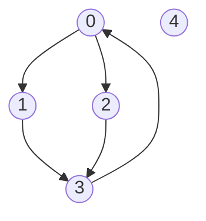

# 哈希表与图练习：从存储规则到访问过程

[教材目录](textbook/index.md) · [编程练习与运行](programming-practice.md) · [树与堆练习指引](trees-practice.md) · [学习记录模板](learning-log-template.md)

先读[第 19 章：哈希表](textbook/19-hash-tables.md)，再读[第 20 章：图的表示](textbook/20-graphs.md)和[第 21 章：基础图遍历](textbook/21-graph-traversal.md)。三章共 30 段自包含 Python 程序，每章包括 5 段讲解程序、2 个例题和 3 个练习参考实现。复制一整段到本机 `.local/lesson.py`，先手算输出，再运行；练习先独立完成，卡住时展开提示，最后核对完整解答。

## 哈希表先核对映射，再核对效率

本书整数键表用独立的列表桶解决冲突，每条记录为 `[键,值]`。容量为 4 时，−3、1、5 的桶号都是 1；同桶只表示需要继续比较，不表示键相等。

| 操作 | 桶 1 的内容 | `size` | 必须解释的变化 |
| --- | --- | ---: | --- |
| 写入 −3→10、1→None、5→20 | `[[-3,10],[1,None],[5,20]]` | 3 | 三个不同键同桶 |
| 把键 1 改成 7 | `[[-3,10],[1,7],[5,20]]` | 3 | 覆盖不增加键数 |
| 删除键 −3 | `[[1,7],[5,20]]` | 2 | 列表剩余记录前移 |
| 再删除键 −3 | `[[1,7],[5,20]]` | 2 | 缺失删除不改变结构 |

`table_get` 的 `[True,None]` 是命中了值为 None 的记录，`[False,None]` 才表示缺失。`table_set` 与 `hash_put` 返回的是“是否新增”；覆盖成功也返回 False。`table_delete` 的 True 表示确实删除，三种接口的布尔含义要分别读清。

每次操作后检查四件事：桶对象独立、每个键唯一、键对当前容量取余等于所在桶号、各桶长度之和等于 `size`。对照[扩容讲解](textbook/19-hash-tables.md)，容量改变时重新计算全部旧键；只增加空桶会让查询与存储位置不一致。基础 `table_set` 不管理容量，需要自动扩容时应从新表开始统一使用 `hash_put`。

做一次退化实验：容量 8，分别存入 0–7 和 0、8、16、…、56，再查询缺失键 64。两表装载因子都为 1，实际比较次数分别为 1 和 8。装载因子受控、分布均匀的假设、倍增搬家可以摊还，是三项不同条件。固定取余的实现仍可能有线性查询和二次累计插入。

最后做[哈希应用练习](textbook/19-hash-tables.md#practice)：频次输出的首次出现顺序由额外列表保存；两数配对在存当前位置前查补数，并只保留每个值的最早位置。分别用空表、负数、重复值和“只有一个 3，目标为 6”检查是否复用了同一元素。

## 把方向、边数和邻居次序写在图旁边

以下是第 21 章使用的有向图，邻接表为 `[[1,2],[3],[3],[0],[]]`。顶点 4 单独存在；0、1、3 之间有环，1 和 2 共同指向 3。



画图时写明箭头的含义。编号不表示处理次序，图画上下位置也不表示距离。对无向图，一条边需要两项相反的邻接记录；对有向图，两条相反方向的边是独立边。这里有 5 条有向边、5 个邻接项；若改成无向模式，必须重新构造相应对称表示，不能只把调用参数改掉。

| 表示与问题 | 该检查什么 | 容易漏掉的成本或前提 |
| --- | --- | --- |
| 邻接表 | 每行独立，端点合法，没有自环和重复 | 查某条边最坏扫描出发点整行 |
| 无向表示 | 每项都有反向项 | 邻接项总数是数学边数的两倍 |
| 邻接矩阵 | 行是起点，列是终点，0/1 表示无边/有边 | 初始化与存储需要二次数量级 |
| 转置或矩阵往返 | 边的端点关系保持 | 邻接行的原排列不一定恢复 |
| 给定路线 | 编号合法，相邻两点有对应方向的边 | 合法游走允许重复顶点，不等于简单路径 |

对照[图的例题](textbook/20-graphs.md#examples)，区分出度零和孤立点，再用出入度总和复查记录数。构造器去重时会线性查行，输入记录数包含重复边；不要把对已有图遍历的 O(n+a) 套到带查重的建图过程。这里 n 为顶点数，a 为邻接项总数。

## 用同一张图比较 DFS 与 BFS

从上图的 0 出发，按给定行顺序运行：

| 方法 | 发现次序 | 0 到 3 的父链 | 如何继续工作 |
| --- | --- | --- | --- |
| 递归或显式帧 DFS | `0,1,3,2` | `0→1→3` | 暂停父帧，先完成当前孩子 |
| BFS | `0,1,2,3` | `0→1→3` | 先处理更早发现、距离更近的点 |

这个例子中两种父链恰好同长，不能据此断言 DFS 保证最短。再用 `[[1,3],[2],[3],[]]` 检查：DFS 可先沿 `0→1→2→3`，BFS 则直接选 `0→3`。BFS 的距离是最少边数，任意带权总成本不属于该保证。

BFS 的手算表应同时记录“已发现”和“尚未处理”，两者不是一回事：

| 刚处理完的顶点 | 尚未处理的队列 | 当前距离，−1 表示未发现 |
| ---: | --- | --- |
| 0 | `[1,2]` | `[0,1,1,-1,-1]` |
| 1 | `[2,3]` | `[0,1,1,2,-1]` |
| 2 | `[3]` | `[0,1,1,2,-1]` |
| 3 | `[]` | `[0,1,1,2,-1]` |

处理 2 时，3 还在队列里，但已经发现，不能再入队或改父边。起点也要在最初标记，避免环重新把 0 入队。恢复路径时沿 parent 反向追踪再反转，核对每条方向边和长度；起点等于目标返回一个顶点，不可达返回空表。

显式 DFS 栈帧为 `[顶点,下一邻居下标]`。对照[进入与完成例题](textbook/21-graph-traversal.md#examples)画出暂停和弹栈过程；一次性把全部邻居压栈并提前标记，未必得到与递归相同的父边。长链使用显式帧，不通过提高递归限制掩盖调用深度问题。

## 把搜索范围和空间口径说完整

以下函数读取已建好的图；r 是可达顶点数，aᵣ 是这些顶点的邻接项数。列表追加采用摊还成本，空间不含输入图。

| 操作 | 时间 | 空间与边界 |
| --- | --- | --- |
| 单源 DFS / BFS | Θ(n+aᵣ+1) | O(n+1)，包含全长状态；DFS 最深可能有 n 个帧 |
| 无权最短路径恢复 | 完整 BFS 后另用 Θ(p) 恢复 p 个顶点 | 父边、逆向临时列表和输出都计入，总 O(n+1) |
| 无向连通分量 | Θ(n+a+1) | O(n+1)，共享标记，不逐个起点重复初始化 |
| 全部顶点对可达矩阵 | O(n(n+a)+1) | 输出 O(n²+1)，临时搜索状态 O(n+1) |
| 多源 BFS，s 条起点记录 | O(n+a+s+1) | O(n+1)，先将全部源标为第零层，重复源只入队一次 |
| 保存完整队列和距离快照 | O(n+aᵣ+r(n+r)+1) | 轨迹 O(r(n+r)+1)，不能沿用普通遍历的线性空间 |

列表游标队列保留已处理前缀，不能只按活跃队列宽度计算空间。即使只有一个顶点可达，本章单源函数也初始化 n 项状态，因此不能省掉时间中的 n。单源搜索不覆盖不可达点；共享标记的外层搜索在无向图上得到连通分量，在有向图上不能直接当作强连通算法。

最后做[遍历练习](textbook/21-graph-traversal.md#practice)，用各单源距离的逐点最小值核对多源结果。有向图“从站点出发到其他点”和“从其他点到最近站点”方向相反，后一问需要先转置图。空源、重复源、越界源以及孤立顶点都要各试一次。

掌握图的方向与遍历后，按[拓扑排序与带权图练习指引](weighted-graphs-practice.md)继续第 22–24 章，区分依赖次序、路线总费用和连接全图的总价。

完成实际学习后，可自行记录：

```bash
cs-study-map study --chapter 19-hash-tables --status reading
cs-study-map study --chapter 20-graphs --status reading
cs-study-map study --chapter 21-graph-traversal --status reading
```

独立完成练习和自测后再自行标记 `completed`。可记录“把 None 值当成缺失”“无向删边漏删反向项”“等到出队才标记，导致 3 重复入队”等具体卡点。实际代码验证范围见[验证记录](verification.md)，教材继续保留 AI 草稿状态。
