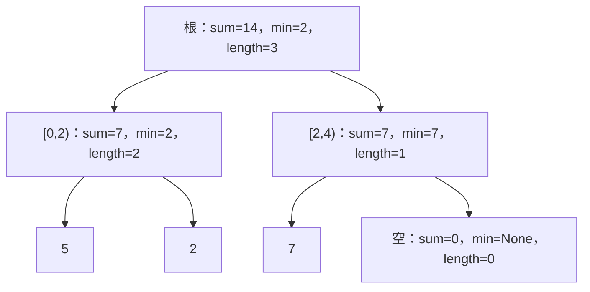

# 单调结构与动态区间查询练习指引

[教材目录](textbook/index.md) · [编程运行方法](programming-practice.md) · [上一批：字符串与区间技巧](string-window-practice.md) · [验证记录](verification.md)

这一组对应第 34–36 章，共 30 段可独立运行的 Python 程序。每章包含 5 节讲解、2 个例题和 3 道带提示及完整解答的练习。先用纸笔说明每个状态的含义，再复制单段完整代码运行，最后更改边界输入。程序只使用内存数据，无需网络、文件或第三方包。

| 章节 | 需要解决的问题 | 学完后应能说明 |
| --- | --- | --- |
| [34：单调栈与单调队列](textbook/34-monotonic-structures.md) | 哪些候选可以永久退出考虑 | 答案确定、被新位置替代和过期是三种不同理由；相等值由题目决定去留 |
| [35：树状数组与频次排名](textbook/35-fenwick-tree.md) | 数据修改后怎样维护前缀和 | 一个槽的范围、两条访问路径、差分停止事件和非负排名条件 |
| [36：线段树与延迟更新](textbook/36-segment-tree.md) | 怎样维护更一般的区间摘要和整段增加 | 结合律、单位元、左右顺序，以及当前总和与尚未下推标记的关系 |

## 先选择方法，再选择数据结构

| 输入与操作 | 这一批可选的方法 | 需要保留的前提 |
| --- | --- | --- |
| 静态扫描，找最近更大或更小位置 | 单调栈 | 写清严格大小关系，返回下标 |
| 每次向右移动一格的固定窗口最大值 | 单调队列 | 过期按下标判断，最新最大值的等值候选被替换 |
| 含负数的最短达标非空区间 | 前缀和上的单调队列 | 先结算旧起点，再插入当前边界 |
| 单点增加与区间和 | 普通树状数组 | 需要加法可抵消；允许负数 |
| 非负桶频次的第 k 项 | 频次树状数组 | 构造及每次修改后均非负，排名从 1 开始 |
| 范围增加、单点查询 | 差分树状数组 | 保留末尾停止哨兵 |
| 范围增加、范围求和 | 双树状数组或加法延迟树 | 双树的权重按同一编号约定；延迟树先下推再部分访问 |
| 点赋值、区间和与最小值 | 三字段线段树 | 摘要能结合，空最小值不冒充零 |

这些接口并不自动检验任意 Python 对象类型。整数列表、整数边界和构造器返回的有效状态是约定；各函数会检查自己声明的范围和语义条件。不要直接修改 `tree`、`nodes`、`size` 或频次副本来绕开接口。

## 单调结构：为每次删除写一句理由

对 `[2,2,1,3,3]` 求下一个严格更大位置，扫描到下标 3 时依次弹出 2、1、0，为它们写下答案 3；最后两个 3 都无解。这里弹出意味着“第一次满足要求的右侧位置已经出现”。

对 `[3,2,2,4,1]` 求前一个严格更小位置，读到第二个 2 时删除第一个 2。这次没有给旧位置填答案，而是在说“新位置更近且不大，以后旧位置不再有优势”。最后结果为 `[None,None,None,2,None]`。

| 任务 | 队尾或栈顶何时删除 | 相等值为何这样处理 |
| --- | --- | --- |
| 右侧下一个严格更大 | 旧值严格小于新值 | 相等不能解决旧位置 |
| 左侧前一个严格更小 | 旧值大于或等于新值 | 相等不能作答案，且较新位置更有利 |
| 窗口最新最大值 | 旧值小于或等于新值 | 相等时最新位置获胜，且更晚过期 |
| 最短达标区间的起点 | 旧前缀大于或等于新前缀 | 新起点给出不小的和与更短的长度 |
| 限长最大和，优先最早起点 | 旧前缀严格大于新前缀 | 相等时旧起点仍可能赢得平局 |

固定窗口程序使用环形槽。用宽度 3、输入 `[8,7,6,5,4,3,2,1]` 画出 `head` 与 `count`，观察队头回绕；再改成递增输入，观察尾部反复被清空。两种情况都不应调用 `pop(0)`。

对 `[1,-1,5]`、目标 5，前缀是 `[0,1,0,5]`，最短答案为 `[2,3)`。再测试空列表配负目标、单个 `-2` 配目标 `-1`，都没有非空答案。不要因为目标非正就返回空区间。

## 树状数组：画块，不猜编号

内部编号 i 保存外部 `[i-lowbit(i),i)`。前缀终点 13 的分解为：

| 访问顺序 | 内部槽 | 外部范围 | 下一编号 |
| --- | --- | --- | --- |
| 1 | 13 | `[12,13)` | 12 |
| 2 | 12 | `[8,12)` | 8 |
| 3 | 8 | `[0,8)` | 0，停止 |

在长度 8 的结构里增加外部位置 2，内部路径是 3 → 4 → 8。逐个写出它们的范围 `[2,3)`、`[0,4)`、`[0,8)`，确认都包含外部位置 2。反过来检查其他槽为何不变，比背两条位运算语句更可靠。

给定 `[4,-2,0,5,1]`，线性构建得到内部表 `[0,4,2,0,7,1]`。直接切片求每个块的和，再与槽值比较；不能仅用另一种树状数组构建法相互对拍。

频次 `[0,2,0,3]` 的排名 1、2 在桶 1，排名 3、4、5 在桶 3。排名 0、6 不合法。把桶 1 减少 3 应失败，并保持计数和树的所有槽不变；减少 2 合法，此后排名 1 转到桶 3。

差分练习统一使用 `[2,0,3,1]`，先给 `[1,4)` 加 2，再给 `[0,2)` 加 `-1`，结果 `[1,1,5,3]`。差分树查询恢复单点；双树公式恢复原列表前缀总和。逐项展开 `D[i]` 在前 stop 项里出现 `stop-i` 次，就能得到 `stop×ΣD[i]−ΣiD[i]`。

## 线段树：区分真实元素、空摘要与待传递更新

三元素 `[5,2,7]` 补齐四叶子时，第四个叶子代表空区间：



不要把空叶写成真实的零。点赋值把位置 1 改为 9 后，根最小值应变为 5。读取一个查询结果字典后改它的字段，再查同一区间，树内数据应保持正确。

用字符串 `a,b,c,d,e,f` 检验查询顺序：`[1,5)` 应为 `bcde`。右边先取出的块更靠右，下一块应放在它前面。只测试和、最小值可能掩盖顺序错误。

加法延迟树另有独立状态。对 `[2,-1,4,0]` 全段加 3：

| 时刻 | 根总和 | 根待传增量 | 左孩子和 | 右孩子和 |
| --- | --- | --- | --- | --- |
| 初始 | 5 | 0 | 1 | 4 |
| 全段加 3 后 | 17 | 3 | 1 | 4 |
| 查询 `[0,1)` 下推后 | 17 | 0 | 7 | 10 |

第二行满足 `17 = 1+4+3×4`；第三行满足 `17 = 7+10`。两行代表同一个逻辑数组 `[5,2,7,3]`。查询会改变内部表示，不能拿整个状态完全不变作为这种查询的验收条件；应比较逻辑值和不变量。

## 独立核验与学习记录

[本批测试](../tests/test_range_structures_lessons.py)使用逐位置扫描、全部短区间、矩形四边枚举、展开小频次表与直接数组更新做参照，另外检查大整数、输入独立、失败原子性与非交换合并。正常样例输出一致后，仍应验证空输入、单元素、全相等、全负数、末尾边界和连续交错操作。

```bash
python -m unittest discover -s tests -p test_range_structures_lessons.py -v
cs-study-map study --chapter 34-monotonic-structures --status reading
cs-study-map study --chapter 35-fenwick-tree --status reading
cs-study-map study --chapter 36-segment-tree --status reading
```

每题写下状态含义、合法范围、相等值规则、正确性理由和时间空间成本，再记录第一处与自己预期不一致的变化。达到自己的学习目标后才标记 `completed`；自动测试通过表示当前实现与已覆盖参照一致，学科专家复核和外部试学仍待开展，教材保留 AI 草稿状态。
