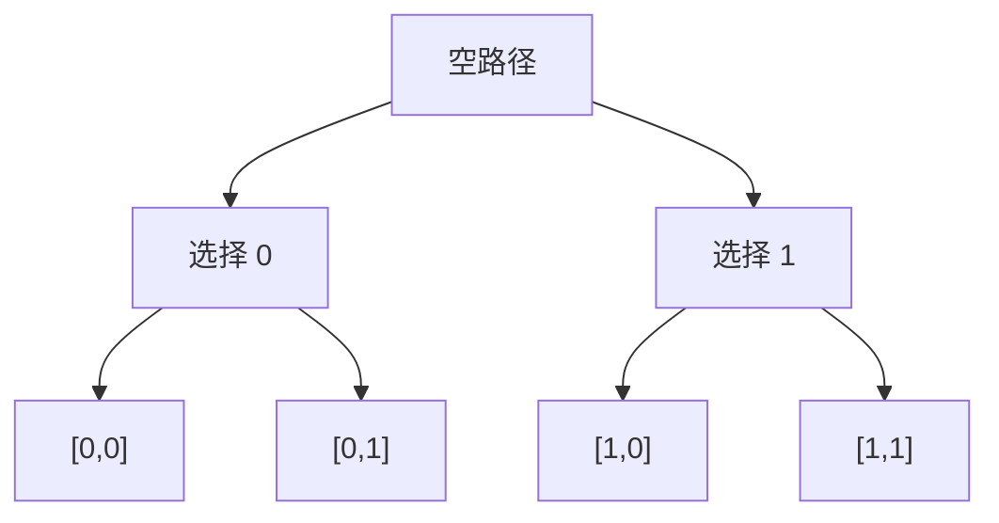

# 回溯、贪心与动态规划练习：选择、证明和复用

[教材目录](textbook/index.md) · [编程练习与运行](programming-practice.md) · [拓扑排序与带权图练习](weighted-graphs-practice.md) · [学习记录模板](learning-log-template.md)

依次阅读[第 25 章：回溯与搜索剪枝](textbook/25-backtracking.md)、[第 26 章：贪心算法](textbook/26-greedy-algorithms.md)和[第 27 章：动态规划入门](textbook/27-dynamic-programming.md)。每章包含 5 节讲解、2 个例题、3 道练习与完整解答，共 30 段独立程序。先预测输出，再运行完整代码，最后改变一个边界条件并解释结果。

## 先明确要返回什么

| 任务 | 必须保留的信息 | 本批示例 |
| --- | --- | --- |
| 枚举全部答案 | 每个不同选择方案及其身份 | 位置子集、皇后、全部简单路径 |
| 求一个最优方案 | 可行性、目标值与正确性依据 | 区间调度、最优合并、最大拖期 |
| 计数、判定或求最优值 | 完整状态、依赖和合并规则 | 路径计数、每项一次子集和、最少硬币 |

同一个问题可以有多种算法，但接口不同不能直接替换。第 25 章的子集和返回所有位置子集，第 27 章的版本只返回能否达到目标；后者没有保存全部答案，不能用更少的输出任务去证明前者实现低效。

## 回溯：返回后现场应恢复到哪里

长度 2 的二进制串形成下面的选择树：



在纸上写出访问叶子 `[0,0]` 后的两次变化：第一次撤销末项，路径回到 `[0]`，才能试 `[0,1]`；整条以 0 开头的分支结束后，再回到 `[]`，才能试以 1 开头的分支。保存在答案表中的叶子副本不应随着撤销改变。

对数值 `[0,2,3,5]`、目标 5，写出四个**位置**答案：`[3]`、`[1,2]`、`[0,3]`、`[0,1,2]`。编号 0 的值为零，仍是一个可以独立选择的项目。达到目标就提前结束会遗漏包含后续零值的答案。

| 输入与目标 | 不剪枝调用数 | 剪枝调用数 | 原因 |
| --- | ---: | ---: | --- |
| `[0,2,3,5]`，目标 5 | 31 | 31 | 拒绝发生在叶层，没有省去后续调用 |
| `[2,3,5]`，目标 11 | 15 | 1 | 全部剩余值之和仍不够，在根即可拒绝 |
| n 个零，目标 0 | 2ⁿ⁺¹−1 | 2ⁿ⁺¹−1 | 全部 2ⁿ 个位置子集都是答案 |

调用次数包含一进入就被拒绝的调用。检查[回溯例题](textbook/25-backtracking.md#examples)时，应同时比较答案集合与调用次数；减少了多少工作必须以实际输入为准。

练习的三个区别尤其重要：值排列的 `tried` 只属于当前深度；括号生成约束每一个前缀；全部简单路径的访问标记必须在退出分支时撤销。普通可达性 DFS 的永久标记不能直接搬过来。

## 贪心：分别核验可行性与最优性

面额 `[1,4,6]`、金额 8，最大面额优先得到 `[6,1,1]`，但 `[4,4]` 更少。面额 `[4,6]` 时，同一规则留下余款 2，原问题仍然有解。分别解释“找到了但不最优”和“该策略失败”的含义。

对于区间调度，手算 `[[0,4],[1,2],[2,3],[3,5]]`，结果为原下标 `[1,2,3]`。然后写出交换证明：将某个最优方案的第一项换成结束最早的任务，其后任务仍能安排，数量保持不变。只检查这些区间确实不重叠，还不能证明最大数量。

| 题目 | 区间或任务约定 | 最优目标 |
| --- | --- | --- |
| 区间调度与最少删除 | 正长度半开区间，端点相接允许 | 最多保留／最少删除任务 |
| 区间选点 | 闭区间，允许单点区间 | 最少的点覆盖全部区间 |
| 截止时间排序 | 全部任务时刻 0 就绪，单机连续、不可中断 | 最小化最大拖期；不优化总拖期 |

合并大小 `[3,5,8,11]` 时依次支付 8、16、27，总费用 51。本教材的 Huffman 规则给出码字 `110、111、10、0`，加权码长也为 51。用不同左右子树得到其他码字可能同样最优；检验时比较前缀性质和总代价，不强迫每位相同。单符号的空码需要另知消息长度，真实文件的码表和元信息成本另计。

本章排序使用插入排序，取最小值使用线性扫描，所以相关实现的最坏时间为平方量级。算法思想与数据结构实现要一起说明，不能把堆版本的时间界直接写到当前代码上。

截止时间的相邻交换条件另核对 [Kevin Wayne 的贪心讲义](https://www.cs.princeton.edu/~wayne/kleinberg-tardos/pdf/04GreedyAlgorithmsI.pdf)；该 PDF 本次由搜索索引读取相关内容，直接打开返回 403。题目、数据与实现按本项目模型设计。

## 动态规划：填表之前写清状态的含义

一步或两步走到 n 的问题中，空距离有一种空方案。对 n=5，三种程序得到相同数量，但保存和访问的信息不同：

| 实现 | 结果 | 实际工作记录 |
| --- | --- | --- |
| 朴素递归 | 8 | 15 次函数调用 |
| 记忆化 | 8 | 9 次调用，4 个非基例状态展开 |
| 自底向上 | `[1,1,2,3,5,8]` | 按距离递增填完 0–5 的全部计数 |

计数问题中的 `1` 是空方案数，最少硬币中的 `0` 是空方案的成本；`None` 表示尚未计算或不可达，具体由状态定义决定。不能把所有问题的初始值统一写成零，也不能凭真假判断某个数值是否存在。

对面额 `[1,4,6]`，最少枚数如下。逐列说明哪个“最后一枚”产生最优值，再从 8 回溯到 0。

| 金额 | 0 | 1 | 2 | 3 | 4 | 5 | 6 | 7 | 8 |
| --- | ---: | ---: | ---: | ---: | ---: | ---: | ---: | ---: | ---: |
| 最少枚数 | 0 | 1 | 2 | 3 | 1 | 2 | 1 | 2 | 2 |

回溯得到 `[4,4]` 后，还要检查面额合法、总额为 8、长度为 2。网格最小费用同样需要检查恢复坐标从起点到终点、每次只右移或下移、避开障碍，且所有格子费用之和等于输出值。负费用在这个无环模型中允许。

## 单数组中的“旧”和“新”由递推决定

| 问题 | 更新顺序 | 读取的状态 |
| --- | --- | --- |
| 网格路径计数 | 每行从左到右 | 同列是上一行的旧值，左邻是当前行的新值 |
| 每个位置最多使用一次的子集和 | 对当前值，从大和到小和 | 较小和必须仍属于加入当前项之前 |
| 第 23 章的限步路线 | 前后两份数组 | 本轮只能读上一轮的距离 |

用一个值 `[2]`、目标 4 检查子集和。若正向更新先把 2 标为可达，再读这个刚写入的值得到 4，就错误地重复用了同一位置。另一方面，网格计数恰好需要本行左邻的新值，因此“绝不读新值”也不是通用规则。

空间压缩后通常不再保留完整状态表。若还要恢复路径，需要另存前驱或重新计算，并重新分析成本。金额 A 或目标 T 很大时，按数值开表的动态规划可能很慢；用少量二进制位写下一个数，不代表可以低成本建立同样长的数组。

实际学习后可自行记录：

```bash
cs-study-map study --chapter 25-backtracking --status reading
cs-study-map study --chapter 26-greedy-algorithms --status reading
cs-study-map study --chapter 27-dynamic-programming --status reading
```

独立完成练习再自行标记 `completed`。可以记录“保存了共享路径”“只验合法没验最优”“把不可达当成零”“单数组重复用了当前项目”等具体问题。实际程序运行与独立对照范围见[验证记录](verification.md)。教材仍为 AI 草稿，代码测试通过不等于外部教学验收完成。
