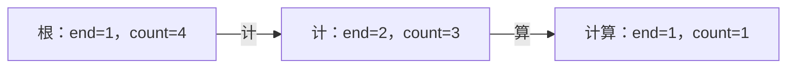

# 字符串、Trie 与区间技巧练习指引

[教材目录](textbook/index.md) · [编程运行方法](programming-practice.md) · [上一批：动态规划进阶](advanced-dp-practice.md) · [验证记录](verification.md)

这一组对应第 31–33 章，共 30 段可以独立运行的 Python 程序。每章先追踪状态，再做两道例题，最后独立完成三道练习；提示和完整解答在章节中分别折叠。程序使用已给定的内存数据，不需要网络、文件或第三方包。

| 章节 | 要解决的问题 | 做完后应能解释 |
| --- | --- | --- |
| [31：字符串匹配与 KMP](textbook/31-string-matching.md) | 一个连续模式出现在哪里，怎样复用已经相等的部分 | 空模式、重叠、前缀表回退、跨块状态与全局位置 |
| [32：Trie 与前缀检索](textbook/32-trie.md) | 许多词怎样共享开头，如何维护词频与查询 | 路径、完整词、子树计数的区别，以及删除和枚举成本 |
| [33：前缀和、双指针与滑动窗口](textbook/33-prefix-window.md) | 连续区间怎样减少重复计算，哪些候选可以永久排除 | 半开边界、可抵消的前缀、单调条件与指针总移动次数 |

## 先固定单位、边界和返回值

字符串下标按 Unicode 码点，不按 UTF-8 字节或用户感知的完整字形；`é` 与 `e` 后接组合重音符是不同序列。先把文本原样写下，再标位置，避免复制和输入法改变组合形式。数字列表使用整数，类型是接口约定，范围和语义前提按各函数说明处理。

| 情况 | 本批接口的约定 | 不要混淆 |
| --- | --- | --- |
| 批量匹配的空模式 | 返回全部 `n+1` 个边界 | 找不到非空模式返回 `[]` |
| 流式匹配的空模式 | 初始化返回 `None` | 不把失败状态传入读块函数 |
| Trie 的空词 | 在根结点保存 `end` 次数 | 空前缀覆盖全库，次数可能更多 |
| 最长已存前缀不存在 | 返回 `None` | 空词存在时可返回合法长度 `0` |
| 合法空区间的和 | 返回 `0` | 非法范围返回 `None` |
| 最短达标窗口无解 | 返回 `[]` | 负元素或非正目标返回 `None` |
| 最长字符窗口的空结果 | 返回 `[0,0]` | 第二个边界总是排除端点 |

## KMP：跟踪同一个字符上的连续回退

模式 `aabaa` 的前缀表为 `[0,1,0,1,2]`。在文本 `aabaaabaa` 中，第一次完整匹配后保留长度 2，下一字符仍是 `a`：

| 时刻 | 读取的字符 | 匹配长度变化 | 理由 |
| --- | --- | --- | --- |
| 文本位置 4 | `a` | 4 → 5 → 2 | 报告起点 0，随后保留完整模式的真边界 |
| 文本位置 5 | `a` | 2 → 1 → 2 | 与模式位置 2 的 `b` 失配，回退后重新比较同一字符 |
| 文本位置 6、7、8 | `b`、`a`、`a` | 2 → 3 → 4 → 5 | 报告起点 4，再保留边界 |

手算结束后，运行例题。把模式换成 `aaa`、文本换成 `aaaaa`，应得到 `[0,1,2]`。若误在成功后归零，会丢掉后两个重叠结果。

流式练习使用模式 `aba`，依次读入 `ab`、空块、`aba`，三个返回值是 `[]`、`[]`、`[0,2]`。最后 `consumed=5`、`matched=1`。试着改变切块位置：在整段文本任意两字符之间切开，或者增加空块，拼接后的全部输出应保持相同。块边界不应重置状态，也不能重复报告旧的结束位置。

第 31 章的三道练习分别检查边界链、旋转切点和不重叠选择。特别比较 `ababab` 与 `ababa`：有周期约束不等于可以用同一片段完整重复，完整分块还要整除总长。

## Trie：每次变更后检查整条路径

存入“计”“计算”“计”和空词后：



每个结点检查 `count = end + 所有孩子的 count 之和`。删除一次“计”后，根 `count=3`，“计”的 `end=1、count=2`，而“计算”的两个计数均保持 1。删除第二次“计”后，“计”的 `end=0、count=1`，路径仍必须存在。

再删除“计算”，当前词库只剩空词，但结点列表仍有三个结点。这是本实现保留历史结点的行为。重新插入“计算”时应复用原路径；失败删除不得提前减少任何计数。用普通词列表或词频表做参照，逐次核对，避免再写另一棵 Trie 充当唯一证据。

枚举顺序要单独检查：先插 `bat`，再插 `ab`，最后插 `ba`，结果按本章规则先报告 `ba`、再报告 `bat`、最后报告 `ab`。它既不是全局首次插入顺序，也不是字符排序。需要“首次出现去重”时，应在读取原列表时立即记录首次遇到的完整词。

枚举使用 `text + char` 构造路径，会复制字符。即使一条很长的单链只输出一个完整词，累计复制仍可能是平方量级。删除保留的旧边、期望哈希成本与输出规模，都应写在成本分析中。

## 区间：先写证明所需的条件，再移动指针

| 任务 | 能使用的方法 | 必须先满足或说明 |
| --- | --- | --- |
| 静态区间求和 | 前缀和相减 | 表与当前数据版本相同，范围合法；允许负数 |
| 一批区间增加后恢复 | 差分的开始、停止事件 | 恢复发生在这一批更新结束后 |
| 两个不同位置的数值和 | 相向双指针 | 输入已非降排序；允许负数和重复值 |
| 最短达标连续区间 | 收缩非负和窗口 | 元素非负、目标为正；记录候选在收缩之前 |
| 最长无重复子串 | 最近位置字典 | 左边界不后退，重复按码点判断 |
| 恰好 k 种字符的区间数 | 最多 k 种减最多 k−1 种 | 统计非空位置区间，不按内容去重 |
| 含负数的指定和区间数 | 更早前缀和的频次 | 先查询后插入当前前缀，保留重复次数 |

对 `[1,-1,5]`、目标 5，正确最短区间是 `[2,3)`，而本章非负窗口接口应返回 `None`，因为输入违反前提。自行去掉检查并跟踪错误过程，可以看到“当前不足就停止收缩”不再可靠；不要通过一组正常样例就推广算法适用范围。

对 `abba`，读到第二个 `b` 后左边界变成 2，随后读到 `a` 时仍为 2。它以前在位置 0，已离开窗口。如果把左边界退回 1，就会把两个 `b` 都纳入。

对 `[0,0,0]`、目标和 0，四个前缀边界的值全部相同。选择两个不同且递增的边界得到六个非空区间。若先把当前前缀加入再计数，会额外包含三个本轮产生的空区间。

## 留下可以回读的练习记录

每题记录五件事：输入契约、状态含义、推进或回退理由、返回位置的核对、成本中包含的复制与输出。用全部短输入或全部连续区间做独立参照，再尝试长重复串、空词增删和零值窗口。

```bash
cs-study-map study --chapter 31-string-matching --status reading
cs-study-map study --chapter 32-trie --status reading
cs-study-map study --chapter 33-prefix-window --status reading
```

完成自己的练习后再标记 `completed`。可记录“完整匹配后丢失重叠”“只看路径没看 end”“字典零计数仍占键”“先插当前前缀误算空区间”等具体卡点。[新增测试](../tests/test_string_window_lessons.py)公开了独立参照与输入范围；代码验证不替代学科专家复核和真实试学，教材继续保留 AI 草稿状态。
