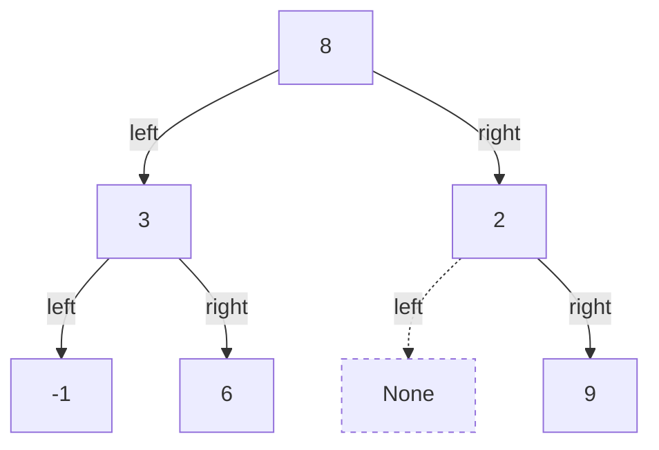

# 树与堆练习指引：形状、键序和最值

[教材目录](textbook/index.md) · [Python 程序运行方法](programming-practice.md) · [递归与分治练习指引](recursion-practice.md) · [学习记录模板](learning-log-template.md)

第 16–18 章各有 5 节讲解、2 个原创例题、3 道练习及完整解答，共 30 段独立程序。练习时先画对象和链接，再写输入约定、返回值和变化后的结构。复制一段完整程序到 `.local/lesson.py`，先预测每行输出，再实际运行与改变边界输入。

| 章节 | 核心问题 | 练习 |
| --- | --- | --- |
| [16：树与遍历](textbook/16-trees.md) | 形状是什么，何时处理根，哪些状态仍需保存 | 叶子求和、指定深度、完全性判断 |
| [17：二叉搜索树](textbook/17-binary-search-trees.md) | 祖先允许什么范围，修改后子树入口在哪里 | 全局键序验证、范围查询、从有序列表构造 |
| [18：二叉堆](textbook/18-heaps.md) | 哪条父子关系可能坏了，如何只修复一条路径 | 排序副本、最大的 k 项、多路归并 |

## 在同一张图上核对遍历与高度

下面是第 16 章的六结点示例。字母是图中对象标识，框内整数才是保存的值；两个不同对象可以有相同值。虚线框表示空位置，不计入结点数。



根深度为 0，高度按最长路径的边数计。这里有 6 个结点、5 条非空父子边、3 个叶子，高度为 2；空树高度约定为 -1，单结点高度为 0。`tree_stats` 还会调用空基例，因此本例总调用为 13，最大同时存活调用为 4。不能把高度、调用数、最大栈深当成同一个量。

| 顺序 | 何时记录当前根 | 本例结果 |
| --- | --- | --- |
| 前序 | 左右子树之前 | `8, 3, -1, 6, 2, 9` |
| 中序 | 左右子树之间 | `-1, 3, 6, 8, 2, 9` |
| 后序 | 左右子树之后 | `-1, 6, 3, 9, 2, 8` |
| 逐层 | 深度从小到大，同层从左到右 | `[8]`, `[3, 2]`, `[-1, 6, 9]` |

先对照[第 16 章例题](textbook/16-trees.md#examples)记录进入、处理中序、离开的事件，再做镜像。镜像两次应恢复每个对象的左右引用；仅比较重复值序列还不足以证明恢复原结构。遍历函数假定输入已经无环、无共享子树，不负责自动检测任意对象图。

原示例不是完全二叉树，因为 2 的左位置先空了，右位置却还有 9。把 9 移到左边才满足从左连续填充。`is_complete` 必须保留空位置的信息；逐层输出函数则有意只返回真实结点，两者用途不同。

## 搜索树每走一步都要保留祖先约束

普通二叉树、中序有序的搜索树和最小堆使用不同约束：

| 结构 | 形状要求 | 数值要求 | 能直接保证什么 |
| --- | --- | --- | --- |
| 本书普通二叉树 | 有限、无环、无共享，每结点至多左右两个孩子 | 值可重复，无大小约束 | 按约定顺序遍历 |
| 本书二叉搜索树 | 同上，不自动平衡 | 左侧所有键严格小，右侧所有键严格大，键唯一 | 中序严格递增，查找可排除一侧 |
| 本书最小二叉堆 | 完全形状，连续列表存储 | 父不大于孩子，允许重复 | 根是最小值 |

根 12、左孩子 5、5 的右孩子 14，是一个易漏的反例：14 满足父亲 5 的局部要求，却违反祖先 12 的上界。做[搜索树验证练习](textbook/17-binary-search-trees.md#practice)时，用空树、相等键和跨祖先边界分别测试。

删除键 12 的进阶例子来自插入序列 `[12, 5, 18, 2, 9, 15, 21, 16]`。下表只列发生变化的位置：

| 位置 | 删除前 | 删除后 | 原因 |
| --- | --- | --- | --- |
| 原根的 `key` | 12 | 15 | 复制右子树最小后继的键 |
| 键 18 结点的 `left` | 指向原 15 对象 | 指向原 16 对象 | 后继虽然没有左孩子，仍有右孩子 |
| 从根可达的对象数 | 8 | 7 | 原 15 对象被摘除，16 仍在树内 |
| 外部保存的原根引用 | 指向键为 12 的对象 | 同一对象，键变为 15 | 本实现不承诺对象永远代表同一键 |

每次操作都写 `root = bst_insert(root, key)` 或 `root = bst_delete(root, key)`，子树递归也要接回返回值。重复插入和缺失删除应保持整份结构不变。测试根删除、叶子删除和单孩子接替时，要同时检查键集合、入口与对象身份。

同一组七个键可以形成高度 2 的树，也可以形成高度 6 的链。普通搜索树查找按高度收费；从严格递增列表按中点构造只保证这次初始形状，之后的普通增删不自动维持平衡。

## 堆先检查形状，再检查有效范围

以列表 `[1, 3, 6, 4, 9, 7]` 为例，采用从 0 开始的下标：

| 下标 | 值 | 父下标 | 存在的孩子下标 |
| ---: | ---: | --- | --- |
| 0 | 1 | 无 | 1、2 |
| 1 | 3 | 0 | 3、4 |
| 2 | 6 | 0 | 5 |
| 3 | 4 | 1 | 无 |
| 4 | 9 | 1 | 无 |
| 5 | 7 | 2 | 无 |

它是最小堆，但列表中 6 出现在 4 前，末项 7 也不是最大值。插入只可能损坏新末项到根的路径；删除最小值后用末项补根，再向较小孩子下沉。下沉前，两棵孩子子树必须已经是堆，不能把它当成能直接修好任意数组的一次操作。

对照[第 18 章建堆例题](textbook/18-heaps.md#examples)，从 `[9,4,7,1,3,6]` 依次处理下标 2、1、0，值比较次数为 1、2、4，总计 7。普通建堆把各子树能下降的高度累加，得到线性总预算；保存每步完整数组的轨迹则需要额外复制，不能沿用普通版本的时间和空间结论。

升序堆排序使用最大堆。每轮开始时，未完成的前缀是最大堆，后缀已排好；交换根与有效末项后，缩小前缀再下沉。不要用整个列表长度覆盖当前有效长度，也不要把这个循环版最坏 `Θ(n log n)` 解释成每个输入都要做同样多次比较。相等记录仍可能交换次序。

## 对齐返回值与空间口径

以下空间不含输入结构；n 至少为 2，h 按边计高度，w 为最宽层。列表扩缩容按摊还成本计算，新增输出另列。

| 操作 | 返回与副作用 | 时间上界 | 辅助空间与输出 |
| --- | --- | --- | --- |
| 递归三序遍历 | 返回列表，原树不变 | O(n) | O(h+1) 栈，另有 O(n) 输出 |
| 显式栈中序 | 返回列表，原树不变 | O(n) | O(h+1) 显式栈，另有 O(n) 输出 |
| 按层返回 | 返回各层列表，原树不变 | O(n) | O(w) 工作区，另有 O(n) 输出 |
| 本书完全性检查 | 返回布尔值，原树不变 | O(n) | O(n)，游标以前的列表位置仍存活 |
| 搜索树循环查找 | 返回键或 None，原树不变 | O(h+1) | O(1) |
| 搜索树递归增删 | 修改链接并返回新入口 | O(h+1) | O(h+1) 栈；新插入另建一个结点 |
| 最小堆入堆／取出 | 修改列表；入堆返回 None，取出返回整数或 None | 摊还 O(log n) | 调整状态 O(1)，堆本身随项数变化 |
| 自底向上建堆 | 修改原列表，返回 None | O(n) | O(1) |
| 循环原地堆排序 | 修改原列表，返回 None | 最坏 O(n log n) | O(1) |
| 堆排序副本 | 返回新列表，输入不变 | 最坏 O(n log n) | 副本与输出合计 O(n) |

最后做[堆应用练习](textbook/18-heaps.md#practice)：最大的 k 项需要保留重数；多路归并只保存各组当前首项，并计算扫描空组的成本。先用独立的排序结果核对答案，再解释为什么维护的候选足够。

之后按[哈希表与图练习指引](hash-graphs-practice.md)继续学习第 19–21 章，把树遍历中的递归、栈和队列用于含环与共同邻居的图。

完成实际学习后可自行记录：

```bash
cs-study-map study --chapter 16-trees --status reading
cs-study-map study --chapter 17-binary-search-trees --status reading
cs-study-map study --chapter 18-heaps --status reading
```

只在独立完成练习和自测后自行标记 `completed`。可记录“删除后继时漏接它的右孩子”“把堆数组直接当成排序结果”等具体卡点。已有代码运行范围见[验证记录](verification.md)，程序检查不替代学科专家审读和学习者试学。
