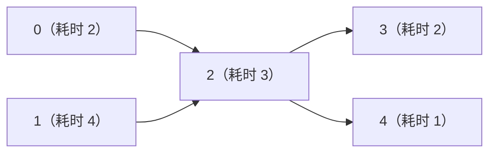

# 拓扑排序与带权图练习：先明确目标，再选择算法

[教材目录](textbook/index.md) · [编程练习与运行](programming-practice.md) · [哈希表与图练习指引](hash-graphs-practice.md) · [学习记录模板](learning-log-template.md)

依次阅读[第 22 章：拓扑排序](textbook/22-topological-sort.md)、[第 23 章：带权最短路](textbook/23-weighted-shortest-paths.md)和[第 24 章：最小生成树](textbook/24-minimum-spanning-trees.md)。三章各有 5 节讲解、2 个例题和 3 道带提示与完整解答的练习，共 30 段自包含 Python 程序。每次复制完整程序到本机 `.local/lesson.py`，先手算状态，再执行核对输出，最后改变一个边界条件。

## 把图中箭头和权重的含义写清楚

| 目标 | 图的解释 | 首先检查的条件 | 本章方法 |
| --- | --- | --- | --- |
| 安排依赖次序 | u→v 表示 u 必须在 v 前面 | 全图有向无环 | Kahn 或 DFS 逆完成序 |
| 求最少边数 | 一次沿边移动成本统一为 1 | 按边数计费 | 第 21 章 BFS |
| 求最小路线总费用 | 权重是沿边付出的费用 | 全图非负权 | 扫描或懒堆 Dijkstra |
| 求含负边的最短路 | 权重可正、零、负 | 从起点可达的负环是否存在 | Bellman–Ford |
| 求 DAG 最短路 | 依赖结构无环，权重可负 | 全图 DAG | 按拓扑序松弛 |
| 求至多 k 条边的最小费用 | 可重复顶点，但最多走 k 条边 | k 为非负整数 | 前后两份距离数组 |
| 用最低总价连接全部点 | 权重是选择这条无向连接的费用 | 合法无向图；不连通则求森林 | Prim 或 Kruskal |

第 22 章允许自环以报告自身依赖；第 23 章允许有向自环以讨论负环。第 20 章的原构造器仍拒绝自环。第 24 章使用无自环、无重复边的无向简单图。不要把不同章节的输入契约默认为完全相同。

## 拓扑排序：就绪、阻塞和真正的环

下面的箭头表示先修依赖，任务耗时写在括号中：



邻接表为 `[[2],[2],[3,4],[],[]]`。先不看程序，写出各点初始入度，再逐项填表：

| 刚处理完 | 尚未处理的队列 | 当前剩余入度 |
| ---: | --- | --- |
| 0 | `[1]` | `[0,0,1,1,1]` |
| 1 | `[2]` | `[0,0,0,1,1]` |
| 2 | `[3,4]` | `[0,0,0,0,0]` |
| 3 | `[4]` | `[0,0,0,0,0]` |
| 4 | `[]` | `[0,0,0,0,0]` |

处理 0 以后，2 还要等待 1。解释清楚“减掉的是哪条来自已完成顶点的入边”，再去运行[入度轨迹程序](textbook/22-topological-sort.md)。若按单位耗时分批，得到 `[[0,1],[2],[3,4]]`；按图中实际耗时，最早完成时间为 `[2,4,7,9,8]`，项目工期为 9。这两个结果采用不同时间模型。

再改用 `[[1],[2],[1,3],[],[5],[]]`：Kahn 可以处理 `[0,4,5]`，但 `[1,2,3]` 留下。DFS 给出的环是 `[1,2,1]`；3 只是环的后继。核验环输出时逐对检查原方向边，首尾必须相同。DFS 遇到黑色邻居说明它已完成，只有遇到仍在当前栈中的灰色祖先才产生回边证据。

完成[三道拓扑练习](textbook/22-topological-sort.md#practice)：每次只有一个就绪点才能保证唯一；按编号最小选择要用堆；DAG 路径计数则按最后一条入边分类相加。用空图、自环、断开部分的环，以及 FIFO 输出 `[0,2,1]` 而最小堆输出 `[0,1,2]` 的图分别检查。

## 最短路：候选费用与确定费用

对 `0→1=7、0→2=2、2→1=1、2→3=8、2→4=12、1→3=2、3→4=1`，按懒堆 Dijkstra 手算：

| 有效弹出 | 新的改善 | 留在堆中的旧记录 |
| --- | --- | --- |
| 0，费用 0 | 1 变 7，2 变 2 | 无 |
| 2，费用 2 | 1 变 3，3 变 10，4 变 14 | 1 的 7 |
| 1，费用 3 | 3 变 5 | 1 的 7、3 的 10 |
| 3，费用 5 | 4 变 6 | 1 的 7、3 的 10、4 的 14 |
| 4，费用 6 | 无 | 此后三条旧记录弹出并跳过 |

用[轨迹例题](textbook/23-weighted-shortest-paths.md#examples)核对事件，再通过父边恢复 `0→2→1→3→4`，检查总费用为 6。候选入堆时还没有确定，费用匹配的有效弹出才完成 Dijkstra 的贪心步骤。等长候选不改写父边，零权环也不能导致重复入堆。

把边 `2→1` 改成负权后，应重新检查算法条件。本教材的 Dijkstra 对全图任何负边返回 `None`，包括不可达部分；Bellman–Ford 只在负环从起点可达时报告失败。负边、负环、源可达负环，以及目标能否从负环到达，是不同判断。发现源可达负环后，本章 Bellman–Ford 返回空距离与父边，不表示所有顶点都受负环影响。

| 返回状态 | 正确解释 |
| --- | --- |
| 距离项为 `None` | 没有已知可达路线；成功算法结束后表示不可达 |
| 距离项为 0 或负数 | 有限合法距离，不能当作无边或未访问 |
| 整个 Dijkstra 调用返回 `None` | 起点越界，或违反本教材全图非负契约 |
| Bellman–Ford 的 `negative_cycle=True` | 源可达负环存在，本接口不交付部分距离 |
| 恢复路径为 `[start]` | 合法零边路线 |
| 恢复路径为 `[]` | 目标越界或不可达 |

最后做[限步数练习](textbook/23-weighted-shortest-paths.md#practice)。`0→1=4、1→2=−2、0→2=9` 在 k=1 时到 2 的费用必须为 9，而不是 2。若第一轮就得到 2，说明读到了本轮刚更新的 1，相当于偷偷走了两条边。`previous` 只读、`current` 写入，才能维护“至多 k 条边”的含义；复制旧值还允许少走几条边。

## 生成树：连接总价和单源距离分别核验

对三角图 `0—1=2、0—2=3、1—2=2`，从 0 出发的最短路树总权为 5，MST 总权为 4。MST 中从 0 到 2 要花 4，并非原图最短距离 3。先写目标函数，再决定是否需要“从起点累计”的距离。

Prim 的 `key[v]` 是当前集合接入 v 的最轻单条边权，更新时用边权本身；Dijkstra 更新的是 `distance[u]+w`。Kruskal 从全图轻边开始，只有两端属于不同集合才接受。并查集父指针用于集合关系，可能不是原图的边，恢复真实树路径要沿选中边的邻接表。

对 `0—1=1、1—2=2、0—2=3、2—3=10、1—3=11`，最轻的三条边把 0、1、2 围成环，却遗漏 3。Kruskal 必须跳过权 3 的边，再接受权 10 的连接，总权 13。每次接受后手算分量数，最后核对：

1. 每条选中边来自原图，权重与端点相符，无重复。
2. 选中边无环，覆盖所有顶点，包括孤立点。
3. 原图每个连通分量都在森林中保持连通。
4. 若原图有 c 个分量，结果有 n−c 条边，输出总权等于这些边权之和。

这些结构检查还不能单独证明最优；对短例子可穷举合法森林比较最低总权，较大的输入依靠割性质证明并配合独立实现对照。等权时允许两种不同边集都最优，不能要求 Prim 与 Kruskal 的列表完全相同。

[生成树练习](textbook/24-minimum-spanning-trees.md#practice)还需分别测试：空图与单点图；不连通时完整树包装函数拒绝；恰好 k 个分量不能被额外负边破坏；新增边替换路径最重边时，全负路径最大权仍应为负数，不能从 0 开始取最大。

## 按实际实现计算成本

以下均读取已建好的合法图，n 为顶点数，a 为邻接项数；无向图边列表含 e 条边，a=2e。空间包含返回结果，不含输入。整数算术按单位成本，列表追加按摊还成本；大整数位数增长另计。

| 实现 | 时间上界 | 空间上界 |
| --- | --- | --- |
| Kahn、显式 DFS 拓扑序、分层 | O(n+a+1) | O(n+1) |
| Kahn 全状态快照，处理 r 个点 | O(n+a+rn+1) | O(rn+n+r+1) |
| 最小堆字典序拓扑序 | O(n+a+n log(n+1)+1) | O(n+1) |
| 扫描 Dijkstra | O(n²+a+1) | O(n+1) |
| 懒堆 Dijkstra | O(n+a+(a+1)log(a+2)) | O(n+a+1) |
| 展平边表的 Bellman–Ford | O(n+na+1) | O(n+a+1) |
| 复制无权表的 DAG 最短路 | O(n+a+1) | O(n+a+1) |
| 至多 k 条边的同步松弛 | O(n+k(n+a)+1) | O(n+1) |
| 扫描 Prim 森林 | O(n²+a+1) | O(n+1) |
| 堆式 Kruskal，采用并查集单次对数界 | O(n+e log(e+1)+e log(n+1)+1) | O(n+e+1) |
| 树上新增边改进总权 | O(n+1) | O(n+1) |

堆版 Dijkstra 可能同时保存同一点的多个旧候选；Bellman–Ford 的缓存边表也是真实额外空间。不要把其他实现的复杂度直接搬到当前程序上。

实际学习后可自行记录：

```bash
cs-study-map study --chapter 22-topological-sort --status reading
cs-study-map study --chapter 23-weighted-shortest-paths --status reading
cs-study-map study --chapter 24-minimum-spanning-trees --status reading
```

独立完成练习后再自行标记 `completed`。笔记可写“把受阻后继认作环成员”“限一条边时读到了本轮新距离”“Prim 使用了累计费用”等具体错误。程序运行、穷举与边界核对范围见[验证记录](verification.md)，教材继续保留 AI 草稿状态。
